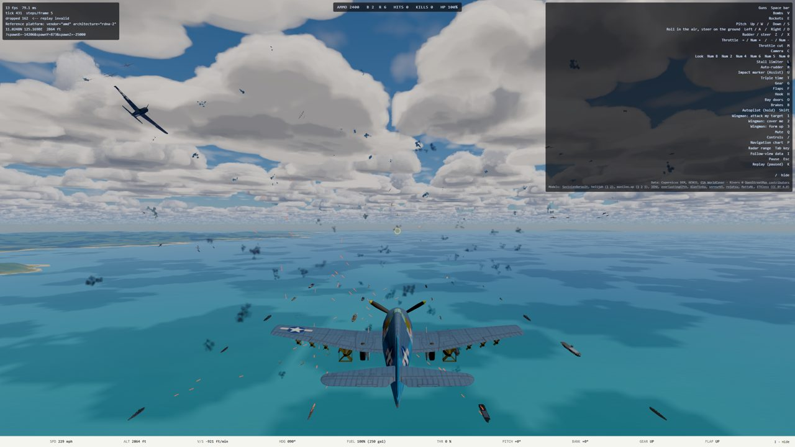
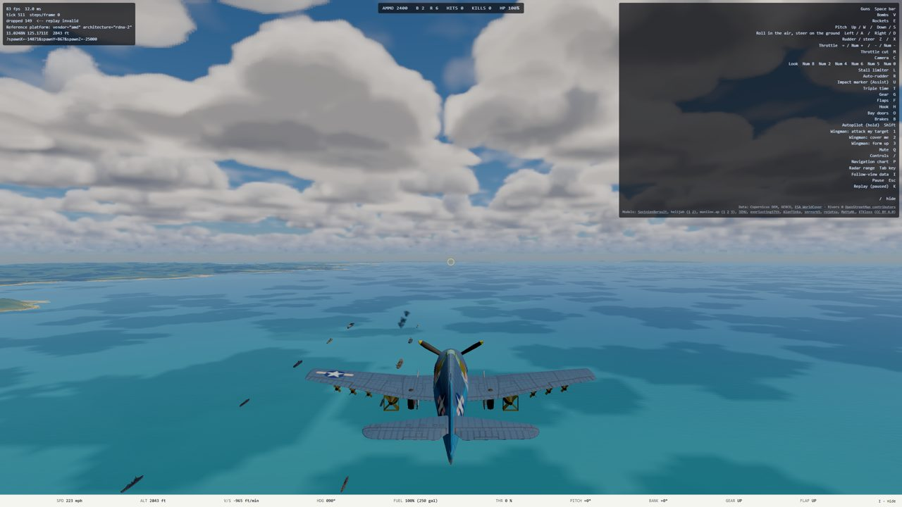
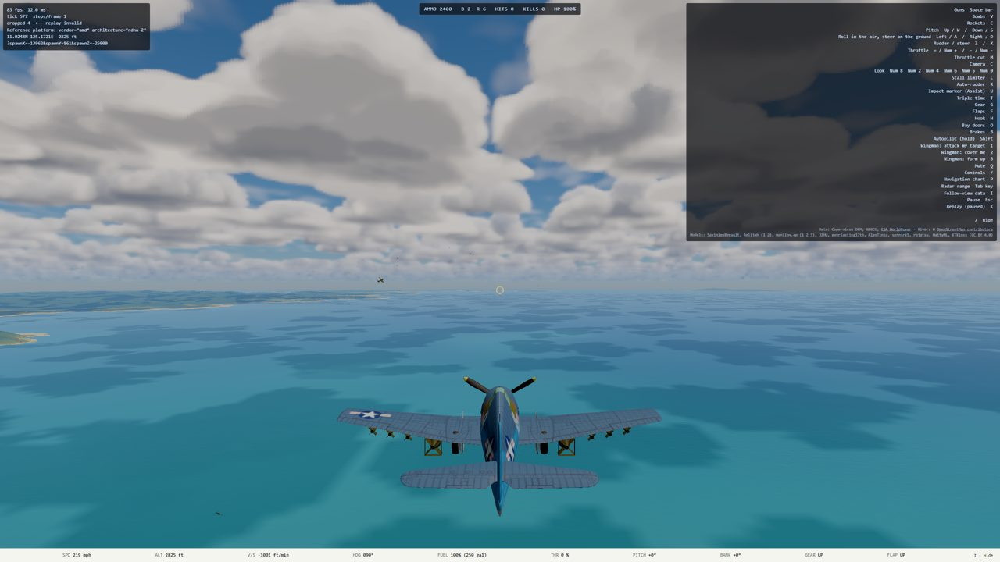
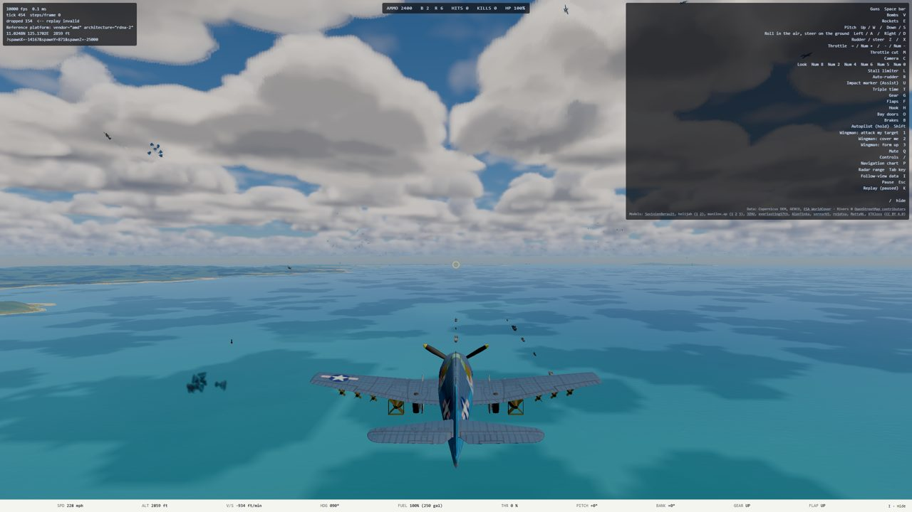

# Entity scaling: how many aircraft and ships fit the budget

Plan: [`docs/superpowers/plans/2026-10-10-entity-scaling.md`](../superpowers/plans/2026-10-10-entity-scaling.md).
Mark's question (2026-10-10): "How many aircraft and ships could we have in the game before going over GPU
budget? 30?" Run unattended; viewing checkpoint is this handoff. Measured 2026-10-10/11 on ryzen (RX 6700 XT,
Mark's console session, Chromium headed through Playwright, slot `ww2airsim-2`), every run under
`hwlock ryzen-budget`, ryzen checked idle before each run (CPU 2 to 6 %, no other Chrome, the only other 3D
client an app called `Agent` at 2.5 %), median of 3 interleaved repeats. No run was discarded.

## The answer to "30?"

**No, not at the 120 Hz bar, in either layout. Today about 5 to 10 aircraft fit.** The GPU is not the
only wall, and in a dogfight not the first: the main thread pays for every airplane's draw calls, and
the sim's bullet collision test grows with the square of the airplanes shooting.

| 30 aircraft, 1440p High | GPU p95 (bar 8.33 ms) | Main-thread work p50 / p95 (bar 8.33 ms) | Sim per tick | At 3x |
| --- | --- | --- | --- | --- |
| **tight** (a furball in front of the camera) | 17.2 ms | 13.0 / 25.8 ms | 6.4 ms | sim falls behind real time (5-tick cap hit) |
| **mission** (one fight with the camera, the rest 5 to 12 mi away) | 14.9 ms (p50 8.0) | 13.1 / 15.8 ms | 0.9 ms | fine (1.2 ms per tick) |

- **At 60 Hz, the mission layout's 30 just fits** (GPU p95 14.9, main thread p95 15.8, both under 16.7 ms).
  The tight 30 does not (main thread p95 25.8 ms; the sim alone is 6.4 ms a tick).
- **Ships are cheap to simulate and dear to draw:** 20 ships cost 0.7 ms per tick, but GPU p95 crosses
  the gate at about 10 and the main thread's p95 at 5 to 10.
- **Distance does not save the GPU today.** Sixty airplanes 5 to 12 mi off cost nearly what sixty in a
  furball do (frozen GPU p50 17.7 against 19.8 ms): the cost is per object, not per pixel. There is no
  level of detail for airframes (`cameraDistanceM` reaches `Airframe.update`, and nothing reads it).

## Where each limit is crossed (1440p High)

N = extra aircraft, M = extra ships, on top of free-flight's own two airplanes and three ships.

| Limit | Tight | Mission | Binds first? |
| --- | --- | --- | --- |
| GPU p95 > 8.33 ms (frozen, the swarm in view) | N 5 to 10 (6.0 -> 11.2); M 5 to 10 (7.95 -> 9.2) | N 10 to 20 (6.4 -> 13.0); M about 10 (8.95) | tight: ties with the main thread |
| GPU p50 > 8.33 ms | N 20 to 30 (7.9 -> 12.1) | N 30 to 45 (8.0 -> 15.0) | |
| Main-thread work p95 > 8.33 ms (120 Hz) | N about 5 (8.3); M 5 to 10 (8.3 -> 9.9) | N under 5 (9.7 at 5; 5.0 at 0); M 5 to 10 | **mission: first** |
| Main-thread work p50 > 8.33 ms | N about 10 (8.4) | N 5 to 10 (7.4 -> 8.3) | |
| Main-thread work p95 > 16.7 ms (60 Hz) | N 20 to 30 (15.3 -> 25.8) | N 30 to 45 (15.8 -> 20.9) | |
| Sim at 3x > one 120 Hz frame (1.5 ticks, i.e. > 5.6 ms a tick) | N 20 to 30 (1.3 -> 7.5 ms a tick) | not reached at 60 + 20 (2.1 ms) | tight at 3x: sim |
| Sim at 3x hits `MAX_STEPS_PER_FRAME` (time falls behind) | N 30 (4.65 ticks a frame, cap 5) | not reached | |

Both layouts cross 120 Hz on the main thread first or together with the GPU. The sim becomes the wall
only in the tight furball, and there it is a cliff: 1.6 ms a tick at 20 airplanes, 6.4 at 30, 11 at 45.

## Tables

The raw rows are in [`2026-10-10-entity-scaling-shots/entity-scaling.jsonl`](2026-10-10-entity-scaling-shots/entity-scaling.jsonl)
(228 rows, three repeats of every point); [`aggregate.py`](2026-10-10-entity-scaling-shots/aggregate.py) turns them into these tables.

### GPU, 1440p High, frozen

Paused (Esc) three seconds after launch, every airframe the layout placed still in view.
**Why frozen:** in a live CPU-bound frame the GPU idles between frames and its timestamps read slower. Measured:
with the whole swarm hidden (`swarmHide=1`, 30 tight) the live 3x window read 18.5 ms GPU p50 against 5.7 ms
paused. So live GPU numbers are not the GPU's cost; they are kept in the CPU table only as a record. Frozen p95
still carries some of this at high counts (paused main-thread work rises to 14 ms at 60 aircraft from draw
submission alone), so read the p95 crossings as upper bounds on cost.

| Layout | Aircraft | Ships | In view (aircraft / ships) | GPU p50 | GPU p95 | Draw calls | Triangles (k) |
| --- | --- | --- | --- | --- | --- | --- | --- |
| tight | 0 | 0 | 1 / 0 | 4.99 | 5.11 | 145 | 2,850 |
| tight | 5 | 0 | 6 / 0 | 5.54 | 6.00 | 343 | 3,075 |
| tight | 10 | 0 | 11 / 0 | 5.95 | 11.22 | 420 | 3,414 |
| tight | 20 | 0 | 21 / 0 | 7.92 | 16.27 | 662 | 3,802 |
| tight | 30 | 0 | 31 / 0 | 12.07 | 17.19 | 858 | 4,092 |
| tight | 45 | 0 | 46 / 0 | 16.55 | 21.04 | 1,357 | 4,499 |
| tight | 60 | 0 | 61 / 0 | 19.79 | 22.40 | 1,746 | 4,930 |
| tight | 0 | 2 | 1 / 2 | 5.15 | 5.54 | 163 | 2,913 |
| tight | 0 | 5 | 1 / 5 | 5.46 | 7.95 | 196 | 2,982 |
| tight | 0 | 10 | 1 / 10 | 5.83 | 9.20 | 257 | 3,170 |
| tight | 0 | 15 | 1 / 15 | 6.58 | 13.42 | 302 | 3,312 |
| tight | 0 | 20 | 1 / 20 | 9.59 | 15.48 | 356 | 3,475 |
| tight | 30 | 10 | 31 / 10 | 14.31 | 17.15 | 966 | 4,412 |
| tight | 60 | 20 | 61 / 20 | 21.97 | 24.28 | 1,954 | 5,555 |
| mission | 5 | 0 | 6 / 0 | 5.58 | 6.17 | 343 | 3,075 |
| mission | 10 | 0 | 11 / 0 | 5.78 | 6.42 | 419 | 3,414 |
| mission | 20 | 0 | 21 / 0 | 6.39 | 12.96 | 658 | 3,802 |
| mission | 30 | 0 | 31 / 0 | 8.01 | 14.93 | 854 | 4,092 |
| mission | 45 | 0 | 46 / 0 | 14.95 | 17.07 | 1,357 | 4,499 |
| mission | 60 | 0 | 61 / 0 | 17.67 | 20.23 | 1,742 | 4,930 |
| mission | 0 | 5 | 1 / 3 | 5.13 | 5.90 | 191 | 2,948 |
| mission | 0 | 10 | 1 / 5 | 5.89 | 8.95 | 235 | 3,053 |
| mission | 0 | 20 | 1 / 10 | 8.04 | 15.53 | 313 | 3,222 |
| mission | 30 | 10 | 31 / 5 | 14.53 | 18.67 | 944 | 4,295 |
| mission | 60 | 20 | 61 / 10 | 20.54 | 21.49 | 1,910 | 5,302 |

"In view" counts origins inside the camera's view at any range, so the mission layout's far groups count;
at 5 to 12 mi they are a few pixels each. Each airframe adds about 26 draw calls and 35,000 triangles; each
hull about 10.5 draw calls.

**Medium** (frozen, GPU p50 / p95): tight 30: 10.36 / 15.05; tight 60 + 20: 19.44 / 21.16; mission 30: 7.21 / 13.65;
mission 60 + 20: 18.75 / 19.40; baseline 4.20 / 4.24. Medium cuts the clouds, about 0.8 ms; the swarm's cost is
the same at either tier, so Medium moves every crossing by at most one step (tight aircraft p95 still crosses
5 to 10; mission 10 to 20). Every Medium point is in `aggregate.py`'s output.

### Main thread and sim, 1440p High, live

`invariants=off` (production's `step`), God mode on the player. Work is `frameFn` start to end, over frames
that rendered; sim is `nextFrameState`'s share, per tick. rAF is the frame interval with GPU sampling off
(it serializes frames while on). "In view" is at the end of the 1x window: the furball spreads as it fights.

| Layout | Aircraft | Ships | In view | Work p50 | Work p95 | Sim ms/tick | 3x work p95 | 3x sim ms/tick | 3x ticks/frame | rAF p50 / p95 | Heap MB |
| --- | --- | --- | --- | --- | --- | --- | --- | --- | --- | --- | --- |
| tight | 0 | 0 | 1 | 4.6 | 5.2 | 0.34 | 5.2 | 0.17 | 0.19 | 6.5 / 8.0 | 613 |
| tight | 5 | 0 | 1 | 5.9 | 8.3 | 0.52 | 6.4 | 0.26 | 0.28 | 6.4 / 8.4 | 623 |
| tight | 10 | 0 | 3 | 8.4 | 11.4 | 1.36 | 8.2 | 0.58 | 0.37 | 7.0 / 8.3 | 633 |
| tight | 20 | 0 | 15 | 11.8 | 15.3 | 1.57 | 13.6 | 1.32 | 0.47 | 7.1 / 8.6 | 658 |
| tight | 30 | 0 | 22 | 13.0 | 25.8 | 6.43 | 60.9 | 7.45 | 4.65 | 10.3 / 14.7 | 690 |
| tight | 45 | 0 | 40 | 30.1 | 55.2 | 11.15 | 88.8 | 9.72 | 4.94 | 30.9 / 47.3 | 739 |
| tight | 60 | 0 | 54 | 54.5 | 111.3 | 13.78 | 125.8 | 15.70 | 5.00 | 77.7 / 110.4 | 667 |
| tight | 0 | 5 | 1 | 6.8 | 8.3 | 0.45 | 8.4 | 0.25 | 0.32 | 7.3 / 8.5 | 627 |
| tight | 0 | 10 | 1 | 7.8 | 9.9 | 0.53 | 9.7 | 0.38 | 0.39 | 8.2 / 9.4 | 645 |
| tight | 0 | 20 | 1 | 9.9 | 12.0 | 0.72 | 12.1 | 0.53 | 0.46 | 9.9 / 12.1 | 652 |
| tight | 30 | 10 | 26 | 15.5 | 25.2 | 6.01 | 67.2 | 7.20 | 4.50 | 27.2 / 45.4 | 731 |
| tight | 60 | 20 | 55 | 57.2 | 129.7 | 14.12 | 133.2 | 15.83 | 5.00 | 124.7 / 152.7 | 750 |
| mission | 0 | 0 | 1 | 4.5 | 5.0 | 0.33 | 5.1 | 0.15 | 0.18 | 6.5 / 8.1 | 624 |
| mission | 5 | 0 | 2 | 7.4 | 9.7 | 0.43 | 8.5 | 0.35 | 0.32 | 7.2 / 8.6 | 633 |
| mission | 10 | 0 | 5 | 8.3 | 10.9 | 0.50 | 8.3 | 0.31 | 0.32 | 7.1 / 8.7 | 620 |
| mission | 20 | 0 | 15 | 11.0 | 13.5 | 0.71 | 11.9 | 0.52 | 0.36 | 10.2 / 13.5 | 642 |
| mission | 30 | 0 | 25 | 13.1 | 15.8 | 0.88 | 15.7 | 1.19 | 0.47 | 12.5 / 17.8 | 667 |
| mission | 45 | 0 | 40 | 17.9 | 20.9 | 1.19 | 21.8 | 0.91 | 0.50 | 31.2 / 47.2 | 686 |
| mission | 60 | 0 | 57 | 22.2 | 26.9 | 1.56 | 28.5 | 1.26 | 0.74 | 31.8 / 76.7 | 730 |
| mission | 0 | 20 | 1 | 8.6 | 10.8 | 0.70 | 11.7 | 0.49 | 0.44 | 9.0 / 11.6 | 640 |
| mission | 30 | 10 | 30 | 15.7 | 20.2 | 1.15 | 23.4 | 1.55 | 0.81 | 15.4 / 21.9 | 698 |
| mission | 60 | 20 | 59 | 24.7 | 37.1 | 2.42 | 37.1 | 2.12 | 1.76 | 31.7 / 77.1 | 733 |

The rAF interval is not pinned on the reference desktop now: 6.5 ms at baseline (the 10.0 ms cadence that
`diagnostics.ts` describes, measured 2026-09-14, did not reproduce in Mark's console session 2026-10-11).
Heap is the DEV build's (`performance.memory`); the swarm adds 100 to 140 MB at 60 + 20, not a limit.

### Headless sim sweep (Node, ryzen)

`REMOTE_RUN_OVERFLOW=0 remote-run sh -c 'npx esbuild tools/ai/swarmSweep.ts --bundle --platform=node --format=esm --packages=external --outfile=tools/ai/swarmSweep.bundle.mjs && node tools/ai/swarmSweep.bundle.mjs 30 3 --profile'`
(2026-10-10). Bundled with esbuild because `tsx` wraps every nested function in `__name` (keepNames), which
cost 13 % of a tick in the profile and read 20 % slower; Vite's dev and build transforms do not. 30 s of sim per
point after 2 s of warm-up, ms per tick, median of 3; the browser's numbers above agree within about 20 %.

| Layout | Aircraft | Ships | Mean | p95 | Max | 3x per 120 Hz frame | 3x per 60 Hz frame |
| --- | --- | --- | --- | --- | --- | --- | --- |
| tight | 0 | 0 | 0.025 | 0.040 | 0.53 | 0.04 | 0.08 |
| tight | 10 | 0 | 0.336 | 1.58 | 2.60 | 0.50 | 1.01 |
| tight | 20 | 0 | 2.64 | 5.60 | 9.80 | 3.96 | 7.92 |
| tight | 30 | 0 | 5.30 | 11.13 | 18.33 | 7.95 | 15.91 |
| tight | 45 | 0 | 11.39 | 19.24 | 31.67 | 17.09 | 34.18 |
| tight | 60 | 0 | 12.75 | 22.16 | 31.31 | 19.13 | 38.26 |
| tight | 0 | 20 | 0.178 | 0.305 | 0.58 | 0.27 | 0.54 |
| tight | 30 | 10 | 5.87 | 11.99 | 18.79 | 8.80 | 17.61 |
| tight | 60 | 20 | 15.06 | 25.77 | 38.56 | 22.59 | 45.17 |
| mission | 10 | 0 | 0.269 | 1.14 | 1.80 | 0.40 | 0.81 |
| mission | 20 | 0 | 0.493 | 2.10 | 3.64 | 0.74 | 1.48 |
| mission | 30 | 0 | 1.54 | 6.46 | 9.98 | 2.30 | 4.60 |
| mission | 60 | 0 | 3.01 | 8.10 | 16.90 | 4.51 | 9.02 |
| mission | 0 | 20 | 0.156 | 0.236 | 0.58 | 0.23 | 0.47 |
| mission | 60 | 20 | 3.37 | 8.87 | 16.28 | 5.05 | 10.11 |

Note the tails: even in the mission layout a single tick reaches 8 to 17 ms when a fight's guns are all
firing, which shows as a hitch at any frame rate. **CPU profile, 60 + 20 (self time):** tight: projectile
contact tests 60 % (`nearestContact` 45 %, `segmentBox` 10 %, `hullHit` 3 %, `inBody` 2 %, `structureHit` 1 %),
garbage collection 12 %, `stepCombat` 11 %, AA 3 %, every AI pilot function together under 2 %, the flight model
under 1 %. Mission: contact tests 45 %, GC 12 %, AI about 4 %.

### Ablations, High

`swarmHide=1` flies the swarm but draws none of it (the most any LOD, impostor or instancing scheme could buy
back); `fx=off` removes the effects pass. GPU frozen, work live 1x, medians of 3.

| Layout | Point | Variant | GPU p50 | GPU p95 | Draw calls | Work p50 | Work p95 |
| --- | --- | --- | --- | --- | --- | --- | --- |
| mission | 30 + 0 | as shipped | 8.01 | 14.93 | 854 | 13.1 | 15.8 |
| mission | 30 + 0 | swarmHide | 5.42 | 6.75 | 146 | 6.0 | 7.8 |
| mission | 60 + 0 | as shipped | 17.67 | 20.23 | 1,742 | 22.2 | 26.9 |
| mission | 60 + 0 | swarmHide | 6.48 | 13.95 | 146 | 6.6 | 8.7 |
| mission | 60 + 20 | as shipped | 20.54 | 21.49 | 1,910 | 24.7 | 37.1 |
| mission | 60 + 20 | swarmHide | 8.10 | 15.36 | 146 | 7.7 | 10.6 |
| mission | 0 + 20 | as shipped | 8.04 | 15.53 | 313 | 8.6 | 10.8 |
| mission | 0 + 20 | swarmHide | 5.71 | 7.61 | 145 | 5.1 | 6.5 |
| tight | 30 + 0 | as shipped | 12.07 | 17.19 | 858 | 13.0 | 25.8 |
| tight | 30 + 0 | swarmHide | 5.68 | 5.82 | 150 | 5.2 | 5.8 |
| tight | 30 + 0 | fx=off | 6.33 | 12.73 | 854 | 10.0 | 12.7 |
| tight | 60 + 0 | as shipped | 19.79 | 22.40 | 1,746 | 54.5 | 111.3 |
| tight | 60 + 0 | swarmHide | 7.03 | 14.77 | 150 | 20.4 | 68.6 |
| tight | 60 + 20 | as shipped | 21.97 | 24.28 | 1,954 | 57.2 | 129.7 |
| tight | 60 + 20 | swarmHide | 12.00 | 16.55 | 151 | 84.6 | 118.3 |
| tight | 60 + 20 | fx=off | 21.81 | 23.62 | 1,954 | 46.1 | 124.4 |

`fx=off` changes nothing measurable in the mission layout (every mission row within noise; all in `aggregate.py`).
With the swarm hidden, what is left of the tight layout's main-thread cost is the sim: small at 30 in the 1x
window (5.8 ms p95), dominant at 60 (work p95 68.6 ms with nothing of the swarm drawn), which is fix 2's territory.

## Cheapest fixes, ranked by measured payoff (recommendations only; none implemented)

1. **Fewer draw calls per airframe, then distance LOD or impostors.** Payoff ceiling, measured (`swarmHide`):
   mission 60: main thread 22.2 -> 6.6 ms p50, GPU 17.7 -> 6.5 ms p50; mission 30: 13.1 -> 6.0 ms and
   GPU p95 14.9 -> 6.8 ms. Each airframe is about 26 draws and costs about 10 us of main thread per draw
   ((22.2 - 6.6) ms / 1,596 draws, mission 60, update included). Merging each airframe's static parts into
   one mesh per material, and drawing anything beyond a few miles as a single low-poly mesh or a billboard,
   gets most of it, because far airplanes cost the same as near ones today. This alone would move the mission
   layout's 120 Hz limit from about 5 to past 30 on the GPU and main thread, if the ceiling is reached.
2. **A broad phase in the projectile contact test** (`nearestContact`, `src/sim/weapons/combat.ts:314`): every
   round tests every airplane's damage zones (each a quaternion transform and a box test), every hull and every
   structure on the map, every tick, with no distance reject. 60 % of a tight tick and 45 % of a mission tick
   by profile, so a bounding-sphere reject should take tight 30 from about 6.4 to under 3 ms a tick
   (**estimated from the profile, not measured**). This is the fix for the tight furball's 3x collapse and for
   the 8 to 17 ms single-tick hitches in every layout. The 12 % GC share points at the per-round `candidates`
   arrays in the same function.

   **Implemented and measured 2026-10-11.** The conservative swept-sphere broad phase and allocation-free
   nearest selection are recorded in [`2026-10-11-entity-contact-broadphase.md`](2026-10-11-entity-contact-broadphase.md).
   Tight 30 fell from 5.56 to 1.01 ms/tick mean; tight 60 + 20 from 22.94 to 4.32. The original estimate was
   conservative. Aircraft draw calls remain the next ranked scaling fix.
3. **Ships: the same draw-call treatment.** 20 hulls: main thread 8.6 -> 5.1 ms p50 and GPU p95 15.5 -> 7.6 ms
   when hidden (mission). Each hull is about 10.5 draws plus per-mount gun laying on the main thread.
4. **Effects in a furball** (`fx=off`, tight 30): GPU p50 12.1 -> 6.3 ms, main thread 13.0 -> 10.0 ms. Only
   matters in the tight layout; a cap on live particles near a big fight, or cheaper muzzle and smoke sprites.
5. **AI tick decimation for far groups: not worth it yet.** Every AI pilot function together is under 2 %
   (tight) to about 4 % (mission) of a tick, so about 0.1 ms at mission 60.

## Viewing checkpoint (captures, 1440p High)

Tight 30 + 0: 
Tight 60 + 20: 
Tight 0 + 10: 
Mission 30 + 0: 
Mission 60 + 20: 

To see it live, on a dev server: `?spawnX=-15000&spawnY=900&spawnZ=-25000&swarmAircraft=30&swarmShips=10&swarmLayout=tight&god=1`
(DEV only; `swarmLayout=mission` for the spread version; `swarmHide=1` to fly it invisible).

## What was built (DEV only; the shipping game is unchanged)

- `src/sim/swarm.ts`: the swarm (`withSwarm`, `swarmFromQuery`, `SWARM_PROBE_ANCHOR`); `main.ts` reads it behind
  `import.meta.env.DEV` through a new `extend` hook on `loadScenarioBundle`. `tests/build/dist.test.ts` asserts
  the parameter names never reach a production bundle.
- `__ww2.cpuFrameSamples()`, `__ww2.setGpuSampling(on)`, `__ww2.entityCounts()`; `?invariants=off`, `?swarmHide=1`.
- `tests/e2e/entityScalingCapture.spec.ts` (E2E_CAPTURE=1, enrolled in `docs/testing.md`); `tools/ai/swarmSweep.ts`
  with `tests/sim/swarmHarness.ts`; `tests/sim/swarm.test.ts` (the water check was seen to fail with the anchor
  moved ashore).

## Not verified, and open

- **Fix payoffs 1, 3 and 4 are ceilings** (nothing drawn), and 2 is an estimate from a profile. None was built.
- **Frozen GPU p95** still carries some down-clocking at high counts; the GPU has no clock lock here. The p50s
  are the steadier numbers.
- **The sim cost depends on how much shooting happens.** The swarm's fighters engage at once and its bombers
  orbit enemy ships; a real mission's fights start later and spread out, so these are worst cases per count.
- **`swarmHide` still runs each airframe's `update`**, so it does not price CPU culling of render-side updates.
- `tools/ai/swarmSweep.ts --checked` (the DEV stepper's overhead) was not run; the browser numbers use `invariants=off`.
