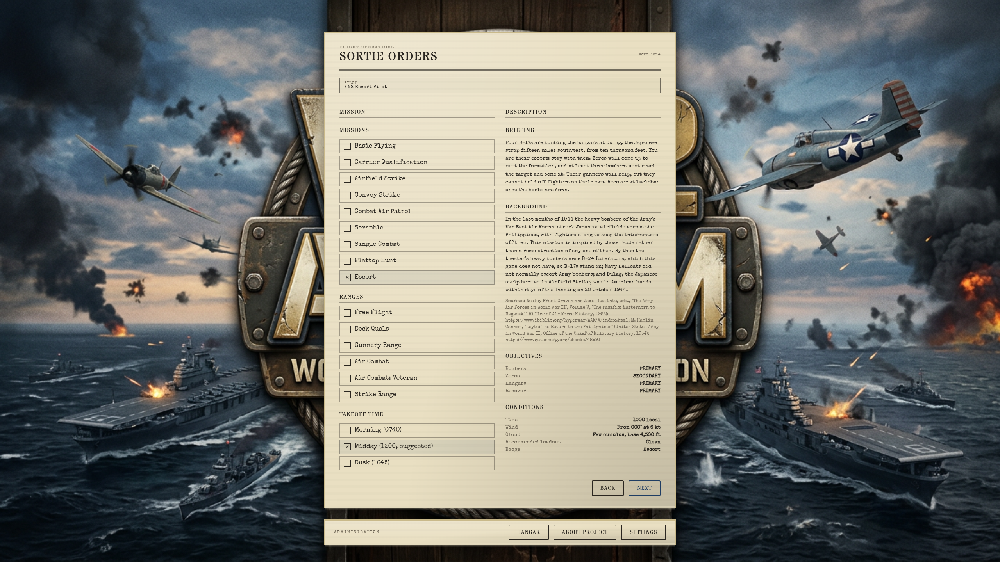
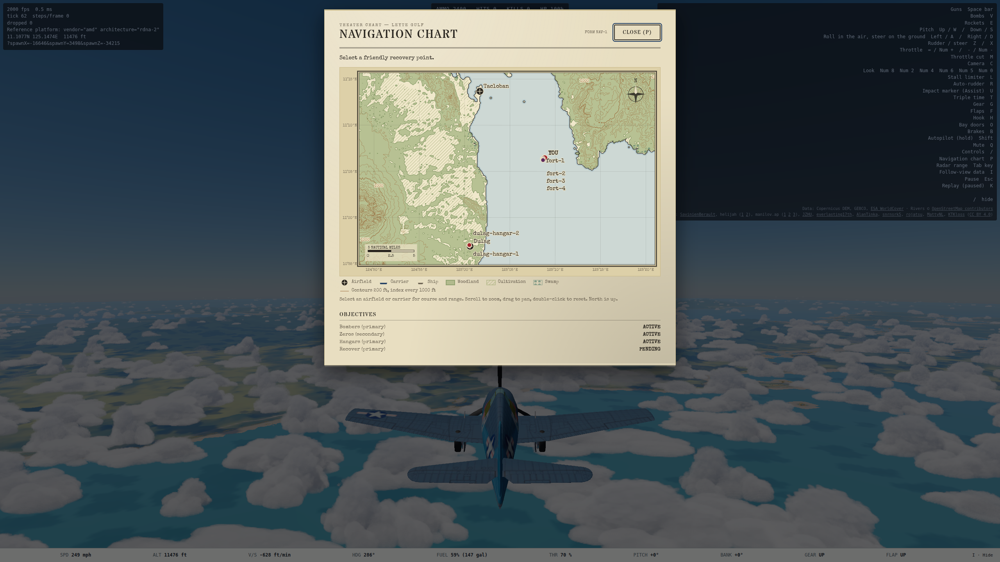
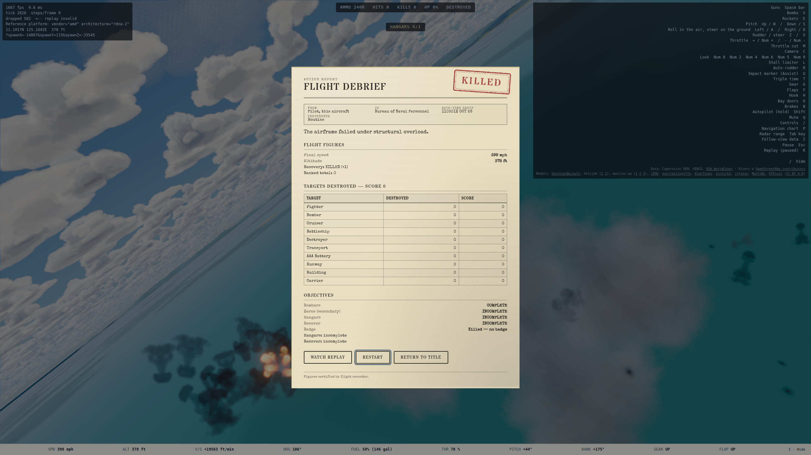

# Escort mission bundle: handoff (2026-10-10)

**Plan:** `docs/superpowers/plans/2026-10-10-escort-mission.md`.

**Branch:** `escort-mission`, in the worktree `.claude/worktrees/agent-a760a41b3978ca82f`, cut from `main` `cbc7d5ff`. **Built on the branch, not merged.**

**Run:** unattended. Mark's checkpoint is the final product, below.

## Look at it

The branch is not served on any windomlane host:

- dev slots 2 and 3 were both held by other sessions at the end of the run;
- the primary host serves `main`.

After a merge:

1. Assert `curl -sS -o /dev/null -w '%{http_code}\n' https://ww2airsim.windomlane.org/` prints `200`.
2. Pick **Escort** on Sortie Orders, or open `?scenario=escort&launch`.
3. Stay with the bombers. The Zeros are called at one minute, from eleven o'clock high, and reach the formation about three minutes in.

Captures, on the nexus 680M, from the E2E run (2026-10-10):

## 1. Bomber formations through turns (E3 open item 1)

**Fault, confirmed first.** E3's mixed formation (B-17 leading a B-29, a G4M and a Ki-21) flew at 200 mph and 8,200 ft through a left and a right 90-degree waypoint, headless through production `advance`. The new test failed against the old behavior, then passed after the fix.

| | Leader's peak bank | Slowest wingman | Worst station error |
| --- | --- | --- | --- |
| Before | 83° | Ki-21 75 mph (33.4 m/s; stall 93 mph); B-29 117 mph (52.3; stall 129) | 1,100-2,450 ft (330-750 m) |
| After (20° limit) | 20° | 188 mph (84.1 m/s) | 130 ft (40 m) |

How the limit was chosen. Same route, measured 2026-10-10; slowest wingman / worst station error:

| Bank limit | Slowest wingman | Worst station error |
| --- | --- | --- |
| **20° (shipped)** | 84.1 m/s | 40 m |
| 25° | 82.0 m/s | 82 m |
| 30° | 79.5 m/s | 97 m |
| 35° | 76.8 m/s | 110 m |

**The fix** (`src/sim/ai/ingress.ts`, `pilotTick.ts`, `attack.ts`):

- A leader with wingmen and **no fixed guns** flies its route, orbit and bomb run on the lift-vector law with a bank limit (`FORMATION_LEADER_MAX_BANK_RAD`, `formationLeaderBankRad`).
- It counts a waypoint reached within its own turn radius (`formationLeaderReachM`). At 20 degrees a 200 mph bomber turns on a 1.4-mile circle, and without this it orbited the 1 km capture ring.
- Fighter leaders keep their full bank. With the limit, `formationSoak.test.ts`'s Hellcat flight overshot its route and missed its last leg (seen on ryzen), so the limit applies to bombers only.
- `attackFlight`'s phase-change recursion now passes `train` on. Before, it dropped `train` for one tick.

**Test:** `tests/sim/ai/formationBombing.test.ts`, "a bomber formation turns a corner". Every wingman stays above 1.3 × its stall speed and within 60 m of station.

- **Seen red** with the limit set to 89 degrees: the B-29 fell to 1.12 × stall.

## 2. Escort pursuit (7f §4.2, decision 11)

**The fix** (`threatensLeader` in `formation.ts`, used in `pilotTick.ts`): a wingman whose target is attacking its leader picks Pursue, whatever 7b's energy terms say. "Attacking" means inside 3 km (1.9 mi) of the leader, with its flight path within 30 degrees of it. Two exceptions keep the existing behavior:

- the attacker has the wingman in its own guns (`threatAstern`), where defending stays right;
- the two are inside the 120 m collision range.

**Test:** `formationCover.test.ts`'s skipped test is un-skipped under the decided wording. Over 240 s the wingman pursues, fires, and never fires while off its target or beyond gun range plus 50 m. The `docs/testing.md` "Known gaps" entry is removed.

- **Seen red** with the override removed: 0 rounds fired.
- **Why 240 s, not the old 120:** in this canned geometry the first pass is a crossing one with no solution. The escort fires on a later pass (measured: on target, nose 0 to 2 degrees off, at 700 ft, around 150 s).
- Hits are not asserted (decision 11).
- The direct-astern case still defends (its test is unchanged and green).

## 3. The Escort mission

**Content:** `content/scenarios/escort.json`, plus one `SCENARIO_OPTIONS` row ("Escort", after Flattop Hunt).

- **The formation:** four veteran B-17s in one finger-four, at 9,800 ft and 200 mph over Leyte Gulf, with the player's Hellcat 1,300 ft behind and 1,600 ft above.
- **The route:** a turn of about 105 degrees at a turn point west of Tacloban, then a run south onto Dulag's hangars. The first bomb falls at about 416 s. The opening call says "seven minutes".
- **The Zeros:** four (a veteran leader, three green wingmen) spawn at 60 s, 15 miles off at eleven o'clock high. They fly an ingress route to the turn point, with Dulag as their destination.

**Objectives:**

| Objective | Kind | Priority |
| --- | --- | --- |
| Bombers | protect `bombers`, `maxLost: 1` | primary |
| Zeros | destroy all four | secondary |
| Hangars | destroy one of `dulag-hangars` | primary |
| Recover | land at Tacloban, after Hangars | primary |

**One engine addition:** an airfield destination may name `aim`, a building id or tag (`scenario.ts`, `airfieldAim`). The run then aims at the middle of those buildings.

- Measured without it: the 32 bombs fell on the runway and missed both hangars, which stand 480 ft (146 m) off the centerline.
- An `aim` that names nothing throws at world build.

**Radio:** four bomber-lead lines, text-only (`null` in `RADIO_LINES`), as B4 and Flattop Hunt did.

**Briefing and history:** cited (Craven and Cate, Vol. V, 1953; Cannon, 1954) and "inspired by". The note says three things outright:

- B-17s stand in for the theater's B-24s;
- Navy Hellcats did not normally escort Army bombers;
- Dulag was American within days of the landing.

### Measured outcomes, headless on the committed terrain (2026-10-10)

| Difficulty | Unescorted (player held far away): bombers lost by 700 s | Zeros downed by the gunners | Escorted (Zeros shot down at spawn) |
| --- | --- | --- | --- |
| Recruit | 3 (first at 292 s) | 2 | no bomber lost; 32 bombs dropped; both hangars down |
| Veteran | 4 (first at 241 s) | 2 | the same |
| Ace | 4 (first at 240 s) | 3 | the same |

The mission needs the escort at every difficulty. Difficulty scales only the Zeros' aim and AA aimed at the player's side, which here includes Dulag's flak at the bombers. The escorted strike is the same at all three: Dulag's flak takes 3 to 10% of a B-17's structure during the bombers' orbit after the run.

## Tests and verification

**`tests/sim/mission/missions/escort.test.ts`, 10 tests:**

- content: the formation, the aim at the hangars' middle, the Zeros' spawn, the protect rule, and the briefing's 15 miles;
- at each of Recruit, Veteran and Ace:
  - unescorted: more than one bomber lost, the objective fails, and the "lost two ships" call plays;
  - escorted: every wingman above 1.3 × stall and within 60 m of station until the drop, 8 bombs each, both hangars down, no bomber lost, and the bombs-away call;
- success: the Zeros down, the strike, a landing at Tacloban, the **Escort** badge;
- failure: two bombers lost, the strike flown, a landing; no badge, and "Bombers: failed" is the only reason.

**Other tests:**

- the `aim` resolution test in `ingress.test.ts`;
- the title picker and mission-list enrollments;
- an Escort case in `tests/e2e/missions.spec.ts`.

**`npm run verify` on ryzen:** 407 files, 5,647 passed, 11 skipped, exit 0. It ran on the mission commit's tree, before two later changes:

- the E2E timeout edit;
- the MASTER_PLAN and GAMEPLAY doc edits.

**E2E on the nexus 680M** (`sg render`, `hwlock nexus-compute`, a loopback vite on port 5197), with all of `missions.spec.ts` and `scenarioPicker.spec.ts`: **15 passed**.

- The Escort case's first attempt timed out in `diveToSea` at 1,000 ft. The player starts 1,600 ft higher than in Convoy Strike, and the GPU was shared with another session's captures. The case now waits 180 s for its dive, and it passed in 1.3 min and again in 49 s.
- **Not run on the reference GPU:** both ryzen dev slots were held by other sessions. No rendering changed, so no budget run is due.

**AI regression check:** `tests/sim`, `tests/content` and `tests/audio` on ryzen, after both AI changes: 166 files, 2,378 passed, exit 0.

## Shared files touched (parallel agents)

| File | Change |
| --- | --- |
| `src/sim/ai/pilotTick.ts` | The bomber-leader bank limit and reach radius on the ingress path; the escort-pursuit override after `decideManeuver`. |
| `src/sim/ai/ingress.ts` | `liftTowardControls` takes an optional `maxBankRad`. New: `FORMATION_LEADER_MAX_BANK_RAD`, `formationLeaderBankRad`, `formationLeaderReachM`. `nextLegIndex` takes an optional reach radius. |
| `src/sim/ai/formation.ts` | `ESCORT_THREAT_CONE_RAD`, `threatensLeader`. |
| `src/sim/ai/attack.ts` | `fly` uses the bank limit; the recursion passes `train`. |
| `src/sim/scenario.ts` | The `aim` field on an airfield destination. |
| `src/render/titleScreen.ts` | One row; it will conflict trivially with M4's range row. |
| `src/audio/radio.ts` | Four `null` lines. |

## Rulings for Mark (taken conservatively, unattended)

1. **Bomber type.** GAMEPLAY says B-17; your decision allowed B-17s or B-29s. Four B-17s satisfy both.
2. **"Most bombers"** means at least three of four (`maxLost: 1`).
3. **"Bomb the target"** means at least one Dulag hangar destroyed. The engine has no "bombs dropped" objective, so a destroyed hangar stands for it.
4. **A landing is required.** Every badge needs a landing at a field (`missionOutcome`), so "Recover at Tacloban" is a primary objective. This adds to the win condition you gave.
5. **No AI wingman for the player.** You described the player alone escorting. The Zeros are four, one of them a veteran.
6. **The Zeros pick their own targets** (ingress engage rule, 7e scoring): bombers or the player, whoever is near. They have no static bomber targets, so they fight the escort when he engages.
7. **After the drop, the bombers orbit Dulag** (E2's `done` hold) under its flak, rather than going home. A home with RTB was not tried: Flattop Hunt found E2's idle clock sends a homed attacker away early. The flak costs a B-17 3 to 10% of its structure over the orbit, and no bomber was lost to it in any run.
8. **Escort pursuit's cone and range:** 30 degrees and 3 km are estimates (`ESCORT_THREAT_CONE_RAD`). Pursuit is forced even against an attacker with more energy. A wingman whose attacker has it in its own guns still defends.
9. **The bank limit applies to bombers only.** Fighter formations keep 7f's tuning.
10. **The history note** says plainly that the mission is not the theater's reality: B-24s, Army escorts, and an American Dulag.

## Open

- **Never hand-flown.** Whether one Hellcat can save three of four B-17s from four Zeros is untested. Headless, the success path removes the Zeros by fiat. Expect to tune the Zero count or skill after Mark's first flight; the bombers and the route are not the knob.
- **Not tested:** the escort-pursuit rule in a real escort, an AI Hellcat on a bomber's wing. The mission has no AI escort, and only 3 slots exist per leader.
- **E3's open items 3 to 5 are unchanged:** the renderer's turret aim, the gunner sound, ammunition.
- `MASTER_PLAN` order row 7: "D torpedoes" struck after checking Track D. Steps 1 to 5 are done: D1 and D3, plus E2's AI torpedo run.
