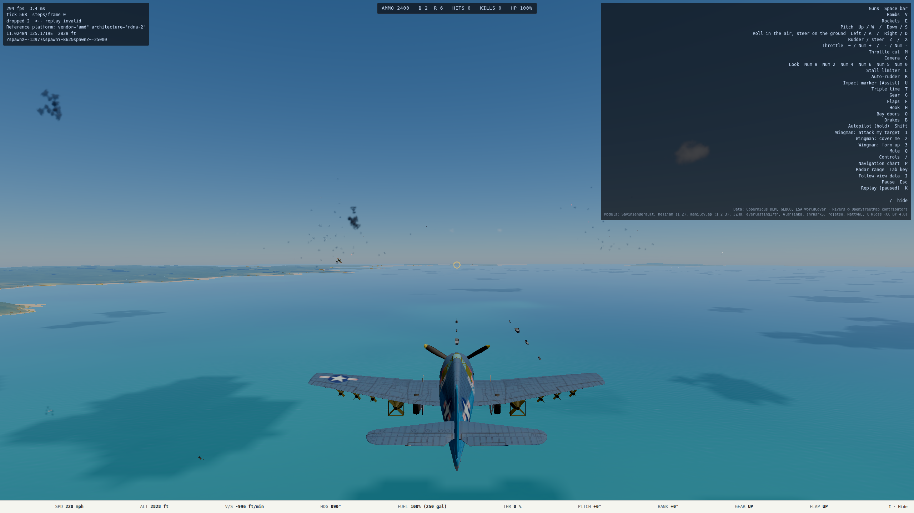
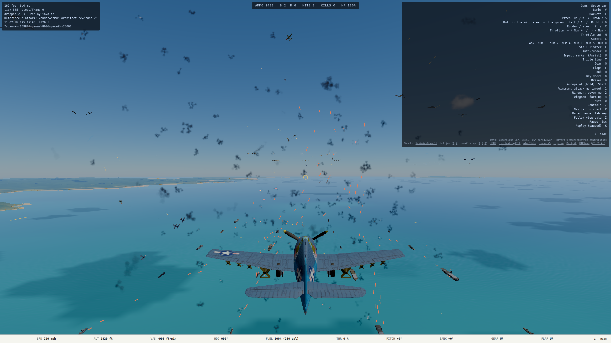

# Aircraft draw-call reduction: shared far LOD

Parent: [`2026-10-10-entity-scaling.md`](2026-10-10-entity-scaling.md), ranked fix 1. Merged to `main` on
2026-10-11 in `0ca520d9`, together with its projectile-contact broad-phase parent (`9157127a`).

## Result

Every intact aircraft beyond 0.75 mi now renders as one shared, lit silhouette mesh instead of roughly 26
draws. The detailed hierarchy returns inside 0.62 mi; the 0.13 mi gap prevents a circling aircraft from
flickering between representations. The player, the nearby engagement, the Hangar bench, and any damaged
aircraft retain the full model.

The implementation is `src/render/scene/airframeLod.ts`, used by both `pivotedAirframe.ts` and the hand-rigged
Wildcat. It bakes all visible authored meshes into one indexed geometry in the airframe frame, carries base
material and vertex colors, and shares that geometry and its one material across every instance of a model.
It deliberately omits landing gear and stores from the distant silhouette. Store meshes are hidden with the
detailed model, and their exact visibility is restored after a drop or a return to near range. Damage at any
distance forces the articulated hierarchy so debris staging is unchanged.

## Measured draw-call payoff

Same current lineage before and after, 2560x1440 High, frozen and live windows from
`entityScalingCapture.spec.ts`; one correctness/performance A/B on nexus's Radeon 680M. Absolute nexus GPU
times are not reference-budget numbers, but draw counts and the direction of the paired change are useful.

| Layout, 60 extra aircraft | Window | Before calls | After calls | Reduction | Main work p50 before -> after | GPU p50 before -> after |
| --- | --- | ---: | ---: | ---: | ---: | ---: |
| Mission | frozen | 1,741 | 437 | 75% | 20.5 -> 11.2 ms | 22.17 -> 17.77 ms |
| Mission | live 1x | 1,727 | 423 | 76% | 29.6 -> 12.7 ms | 21.68 -> 16.26 ms |
| Tight | frozen | 1,745 | 1,025 | 41% | 21.1 -> 15.4 ms | 24.33 -> 20.31 ms |
| Tight | live 1x | 1,662 | 953 | 43% | 26.8 -> 19.7 ms | 23.13 -> 22.63 ms |

Mission gains more because only its engagement half a mile ahead stays detailed; its remaining groups are 5
to 12 mi away. The tight layout spans about 0.2 to 1.2 mi, so the 0.75 mi threshold intentionally leaves the
near half detailed. The proxy retains the source triangles: this pass attacks submissions without accepting a
new silhouette. A later low-poly proxy could reduce vertex cost too.

The first non-indexed prototype added about 70 MB at mission 60. Preserving the source indices and filling
typed arrays directly reduced the final observed delta to about 9 MB (685.6 -> 694.4 MB) while keeping the
same 437 calls.

## Visual checkpoint

The 2560x1440 captures show the near aircraft still fully painted and articulated, with the distant aircraft
reading as small lit silhouettes. Smoke, tracers, ships, and combat are unmodified.

## Verification

- Focused render tests: 46 passed (`airframeLod`, `pivotedAirframe`, `wildcat`).
- TypeScript and ESLint: passed after the indexed-proxy refinement.
- Full `npm run verify`: 6,236 passed, 11 skipped, with two unchanged parent failures (`ship.test.ts`'s
  stale registered-model list and `escort.test.ts`'s easy-loss expectation). The entity soak also timed out
  once while the shared host was saturated, then passed 5/5 in isolation on both this branch and its parent.
- Real browser, nexus GPU: mission/tight 60 + 0 and 60 + 20 completed with no WebGPU validation errors.
- Reference RX 6700 XT timing: pending a clean CPU window; the first attempt was discarded when unrelated
  `remote-run` jobs drove Ryzen to 96% CPU. Its deterministic renderer counts agreed (437 after, 1,741 before).

## Open

- The far mesh is a draw-call LOD, not a triangle LOD. Simplifying its shared geometry or generating a baked
  impostor is the next lever if reference GPU vertex cost still matters.
- The full near model remains roughly 26 draws. Static-part consolidation below 0.75 mi would help dense close
  furballs, but the asset build already joins every non-articulated node it safely can; further reduction likely
  needs instancing or a distinct near proxy rather than another blind join.
