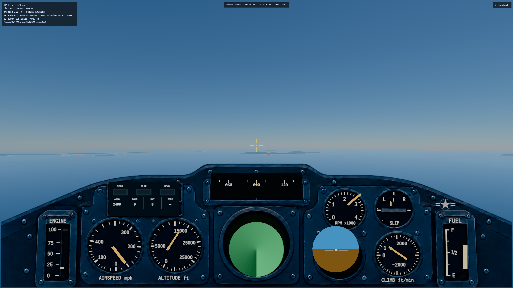
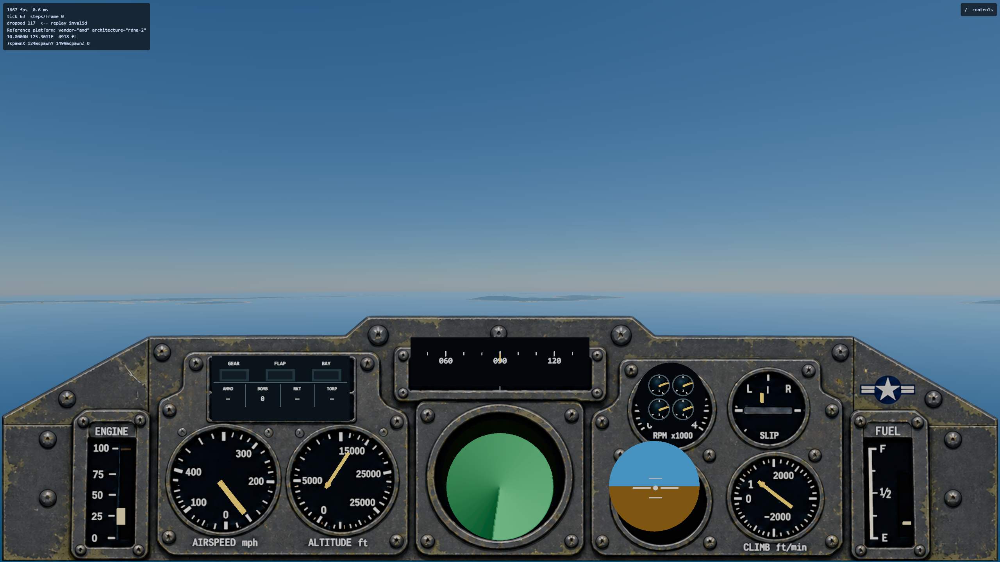
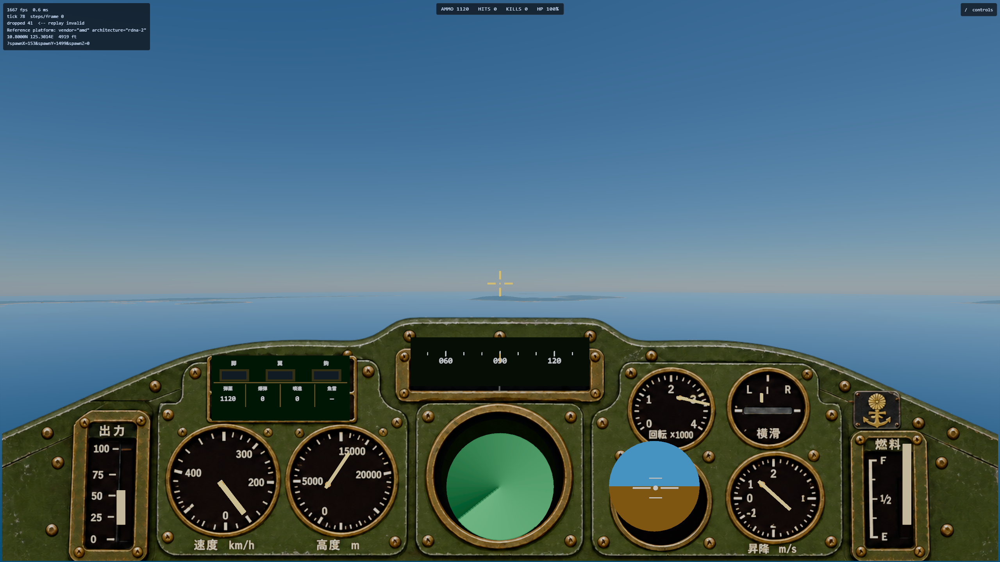
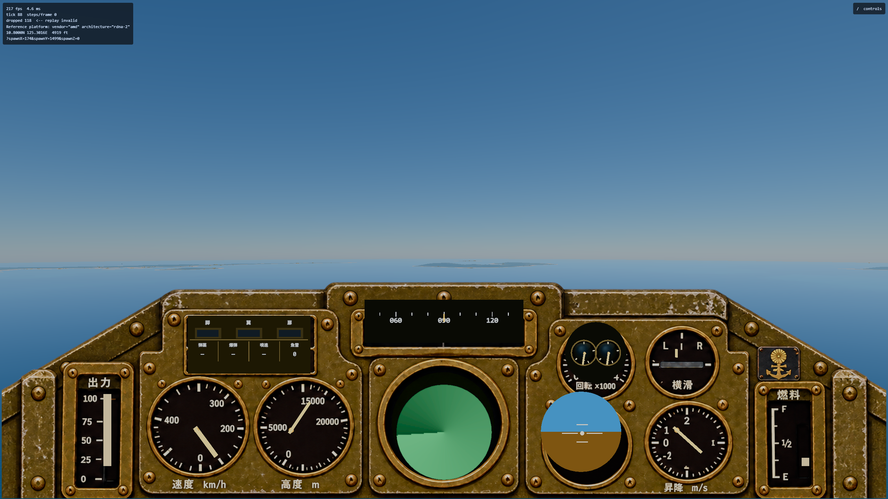
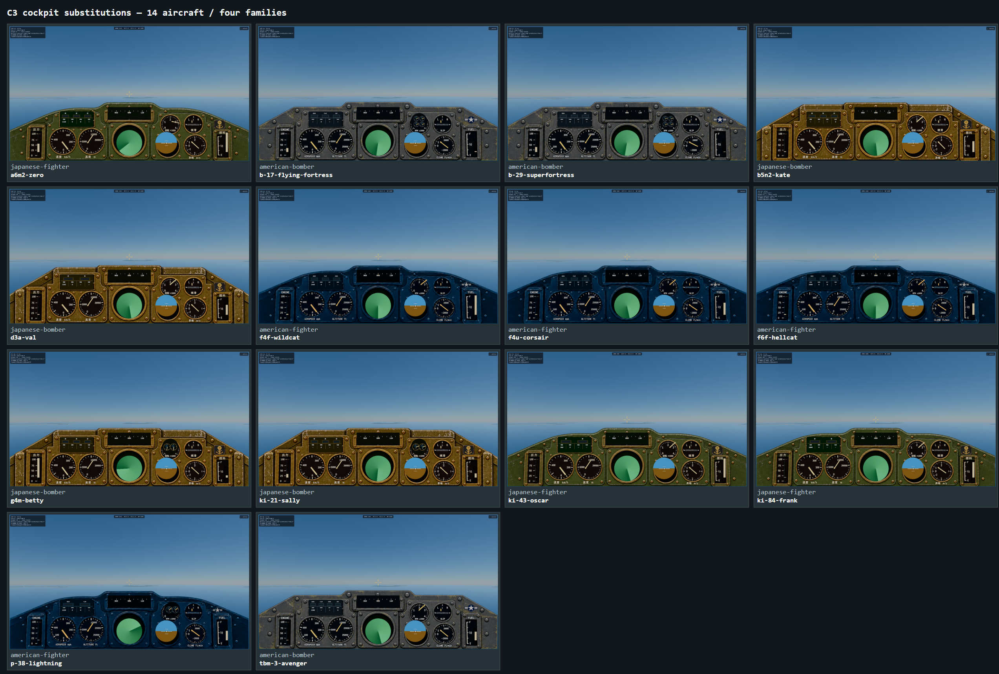

# Handoff: C3 four-family cockpit dashboards (2026-10-11–12)

**Branch:** `c3-cockpits`; worktree `/home/mark/projects/ww2airsim-c3-cockpits`, cut from
`main` at `ee3d73da`. **Plan:**
`docs/superpowers/plans/2026-10-11-c3-cockpit-families.md`. **Run:** unattended;
final-product checkpoint only. This branch is not merged or deployed.

## Product result

The former universal panel is now one builder driven by four explicit cockpit families:

| Family | Aircraft |
| --- | --- |
| American fighter | F4F, F6F, F4U, P-38 |
| American bomber | TBM-3, B-17, B-29 |
| Japanese fighter | A6M2, Ki-43, Ki-84 |
| Japanese bomber | D3A2, B5N2, G4M1, Ki-21 |

The enrollment table names all fourteen flyable ids and fails closed for an unknown aircraft. Each
family keeps a stable primary row, auxiliary row and status zone. Gear, hook and bay indications are
derived from the actual airframe capability, and the reflector sight appears only on explicitly
enrolled aircraft with pilot-fired forward guns. The common radar remains visually separate as the
same clip-on game aid used before C3.

Fighter and bomber families have different coaming crowns and proportions; American and Japanese
families have distinct, texture-backed fascia materials, fasteners, wear, service markings and
insignia. The approved art is the fixed dashboard while the live indicators remain deterministic
geometry on top. These are deliberately readable game cockpits, not literal interiors. Seats,
controls, sidewalls, clickable systems and fourteen modeled cockpits remain out of scope.

## Instruments and RPM

American faces retain mph, feet, feet/minute and US gallons. Japanese faces use km/h, metres, m/s
and litres, with Japanese labels throughout, including the throttle and fuel columns and their
empty/full marks. The glyph-limited Noto Sans JP SemiBold asset is loaded before canvas text is
rasterized, so the result does not depend on an operating-system CJK font. Its source, SIL OFL 1.1
license, 9,724-byte size and SHA-256 are recorded in `content/fonts/NOTICE.md` and `ASSETS.md`.

Every engine spec now supplies a count, idle RPM and rated RPM. `AircraftState.engineRpm` follows
throttle through a deterministic 0.45-second exponential lag and the existing per-engine damage
output channels. Negative-G cutout and a dead output wind a needle down. Single-engine aircraft use
the full-size RPM face. Multi-engine aircraft use one separate, numbered mini-dial per physical
engine: two side-by-side for twins and a 2×2 cluster for the B-17 and B-29. The P-38 has two physical
dials even though its aggregate damage output is repeated until its content gains separate engine
hit zones. This state is display-only: it has no path back into thrust, fuel, propeller efficiency,
control authority or any other flight term. The production fixed step reuses one precomputed blend
instead of evaluating the same exponential for every airplane on every tick.

The chase-view flight-data strip remains its compact pre-C3 set; slip and RPM are cockpit-only.

## Reference captures

These are the inspected 2560x1440 frames from headed Chromium on the Ryzen RX 6700 XT. The capture
suite launched every flyable aircraft, selected cockpit view, advanced throttle, asserted clean
WebGPU validation/console output and then built the contact sheet from those exact frames.

| View | Capture |
| --- | --- |
| American fighter, F6F |  |
| American bomber, B-17 |  |
| Japanese fighter, A6M2 |  |
| Japanese bomber, G4M |  |
| All 14 substitutions |  |

The final visual pass confirmed the family silhouette/palette differences, readable primary faces,
Japanese glyphs and units, conditional sight/status equipment, and one/two/four-engine RPM
presentation. The 2026-10-12 feedback pass enlarged and recentered the live radar and attitude
faces so each fills its circular fascia opening, and replaced shared multi-needle RPM presentation
with the separate per-engine mini-dials described above.

## Verification

- `npm run typecheck` passes after the final implementation and capture-tool changes.
- Focused panel, layout, feedback, family enrollment and engine-RPM coverage passes 78/78 after the
  2026-10-12 alignment and per-engine-dial changes.
- Nexus's real Radeon 680M preliminary capture passed 15/15 (fourteen aircraft plus contact sheet).
- The final headed Ryzen RX 6700 XT reference capture passed 15/15 in 1.8 minutes, with no WebGPU
  validation errors or captured page/console errors.
- `git diff --check` passes.
- The broad `REMOTE_RUN_OVERFLOW=0 remote-run npm run verify` gate passed typecheck, lint and
  dependency analysis. Vitest passed 6,242 tests with 11 skipped. Six assertions failed in that
  first broad run: four were stale C3 layout expectations corrected by the final 78/78 focused
  rerun; the remaining two are the independently reproduced baseline assertions below.

Two failures in the first full-suite run were proved unrelated to C3 rather than hidden or weakened:

- Escort's easy/unescorted case expects more than one bomber lost but deterministically loses one.
  The exact failure reproduces on untouched `main` (9/10 pass in that file).
- `ship.test.ts` has a stale hard-coded registry string that omits the three recently registered
  `*-blender` ship models. The exact failure reproduces on untouched `main` (20/21 pass).

## Delivery and remaining boundaries

The design, implementation plan and final handoff were delivered successfully through the
repository mail tool on 2026-10-12. All three documents are also committed in-repository as the
source of truth.

Detailed historical face layouts, manifold/oil/temperature systems, propeller controls, clickable
switches and modeled interiors remain intentionally deferred. Japanese labels are functional,
period-flavoured game labels rather than a claim that every airframe carried these exact words,
fonts and placements.
