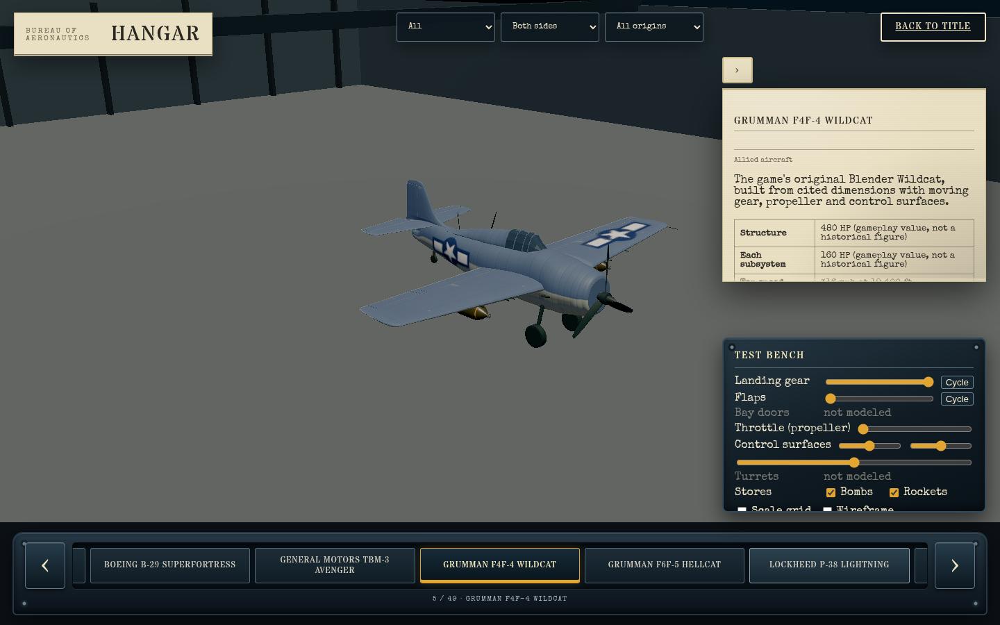
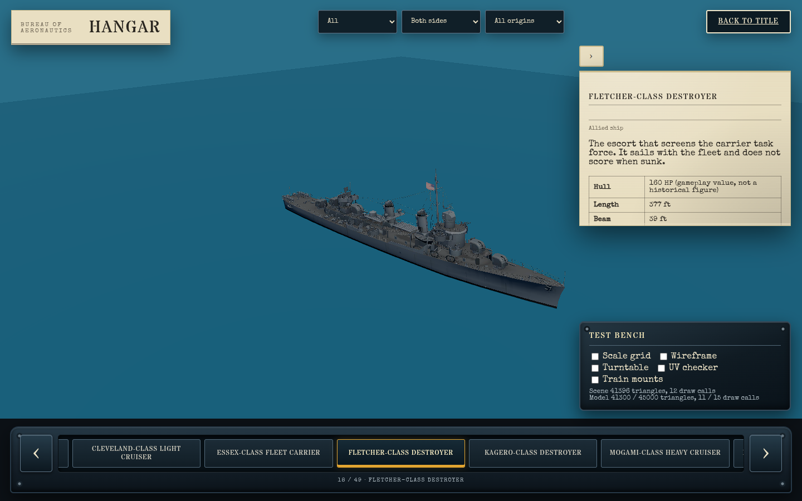
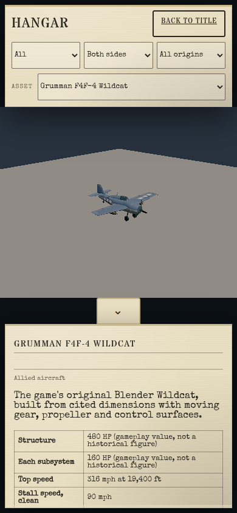

# Desktop Hangar UI handoff (2026-10-11)

This was a bounded, unattended redesign in the `hangar-desktop-ui` worktree. It did not need a separate design or execution plan. The mobile Hangar was an explicit compatibility boundary: the existing compact picker, plain inspection stage and combined bottom sheet remain the layout below 821 CSS pixels.

## What shipped

- Desktop uses the full width for the object. The library is a horizontal cockpit-metal rail below it, with large previous/next buttons, an amber current selection, a position/name readout, mouse scrolling and Left/Right keyboard navigation. Kind, side and origin selectors remain at the top, with the Bureau of Aeronautics/Hangar identity and Back to title link.
- The details dossier and test bench are independent overlays. Details occupy the upper right and can collapse without hiding the smaller lower-right bench. On phones the bench is reparented into the original details sheet so its prior collapse and scrolling behavior are preserved.
- Aircraft, vehicles and ordnance stand in a generated, scale-aware hangar with a thick floor, back/side walls, an open camera side, V roof, trusses and ribs. The solid floor keeps below-grade orbit views from turning transparent. Ships remain on a plain blue water stage; a dry dock is deferred because it needs scale-aware dock geometry and would be a separate visual feature. Buildings retain the outside neutral stage.
- The model fills more of the desktop stage. Selecting a distant catalog item scrolls only the rail; it cannot drag the document and clip the fixed overlays.
- Pivot gizmos and their dead model-probing path were removed. The bench now offers a one-foot-line scale grid with ten-foot majors, off by default and retained across object changes. The renderer still uses meters internally.
- The Hangar test hook exposes the active environment and grid visibility. Automated coverage owns environment mapping, default/toggle persistence, the desktop rail and overlay geometry, carousel navigation, and the unchanged phone layout.

## Visual checkpoint

| View | Capture |
| --- | --- |
| Aircraft in the desktop V-roof hangar, with the separate dossier, bench and selected carousel item |  |
| Ship on water with the same desktop chrome |  |
| Preserved 390 × 844 phone layout and plain stage |  |

## Verification

- Nexus real WebGPU, full `tests/e2e/hangar.spec.ts`: 25 of 26 passed on the first run. The one failure was an M4 restore frame whose decoded pixels were identical but whose PNG byte stream differed. The test now compares decoded pixels rather than PNG container bytes while retaining a zero-changed-pixel restore requirement.
- Nexus real WebGPU: the corrected all-turret motion/restore check passed 1 of 1. The final desktop/mobile layout, carousel, grid and environment set passed 5 of 5.
- Ryzen: TypeScript and focused ESLint passed; four focused Hangar unit files passed 44 of 44; the production build passed.
- `git diff --check` passed.

No deployment was performed.
