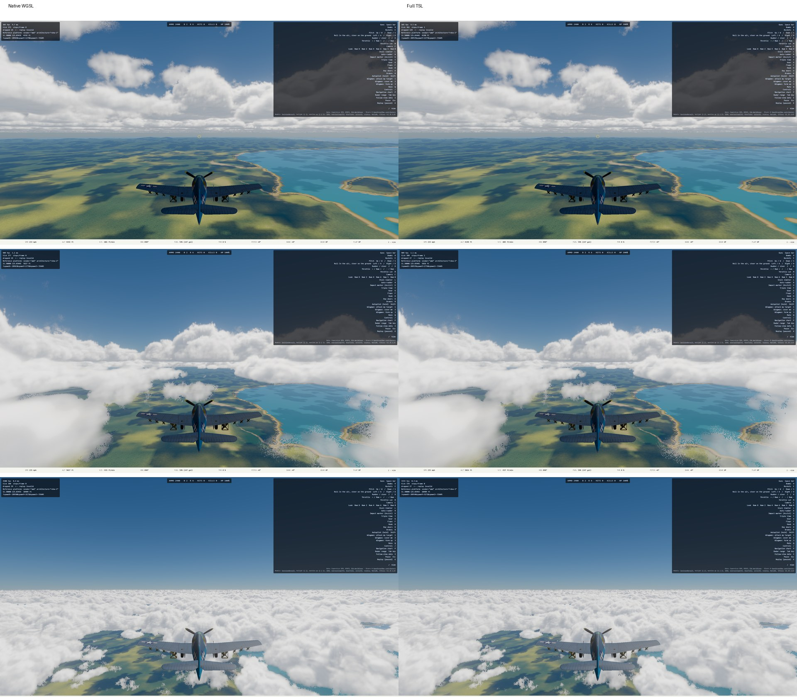

# K Clouds v3 — full TSL port handoff

**Date:** 2026-10-11  
**Branch:** `clouds-v3-tsl-port`  
**Base:** `b8c17fb7`  
**Worktree:** `/home/mark/projects/ww2airsim-clouds-v3-tsl`  
**Disposition:** complete working experiment; keep native WGSL authoritative

## Outcome

The accepted Takram-derived plain-cloud renderer now has a complete parallel
Three Shader Language implementation behind the DEV-only selector
`?cloudRenderer=takram-tsl`. The density field, weather tiling, ray march,
lighting, 2×3 temporal reconstruction, broad soft-edge resolve and
reversed-depth scene composite are all TSL-generated. No cloud rendering stage
embeds hand-written WGSL.

The experiment succeeded technically and visually. It did not earn promotion:
the TSL implementation is 32–46% slower at p95 than the conservative native
whole-frame estimate, beyond the plan's 15% allowance. It remains under the
8.33 ms game gate, so it is useful, flyable research code. `legacy` remains the
default; `takram` remains the preferred Takram renderer. Main, production and
deployment are unchanged.

## How to view it

- Full TSL: `https://ww2airsim-3.windomlane.org/?spawnX=289068&spawnY=1300&spawnZ=-55605&launch&cloudRenderer=takram-tsl&cloudTier=high`
- Native comparison: change `cloudRenderer=takram-tsl` to
  `cloudRenderer=takram`.

These URLs are the isolated worktree's temporary slot, not a deployment.

## Visual comparison

The paired 2560×1440 Ryzen captures match in weather placement, silhouettes,
lighting direction, opacity, scene-depth ordering and soft-edge treatment. The
thin near-cloud stippling is present in both columns. It is the accepted native
artifact, not a regression introduced by TSL.

## Architecture

- `takramTslAssets.ts` loads the weather and turbulence maps as Three textures,
  expands the R8 volume assets to portable RGBA8 `Data3DTexture`s, and uploads
  the accepted averaged 3D shape mip chain.
- `takramTslCloudPass.ts` builds one laid-out density function per material,
  renders radiance/opacity plus representative depth into an MRT at one-sixth
  resolution, resolves into full-resolution ping-pong history, and composites
  against the game's reversed depth.
- `main.ts` loads and constructs this path only for `takram-tsl`; selecting
  `takram` still follows the untouched native implementation.
- Diagnostics and focused tests name the renderer explicitly, so native and
  TSL evidence cannot be confused.

## Correctness evidence

- Touched unit test: `tests/render/clouds.test.ts` — 10 passed.
- TypeScript typecheck — passed.
- Touched ESLint set with zero warnings — passed.
- Focused real-game TSL flight on the Ryzen WebGPU browser — passed in 12.1 s.
  It rendered clouds, composited into the game, reset history on a camera cut,
  and reported no console, page or WebGPU validation errors.
- Final native and TSL capture runs — one passed each, with no validation
  errors.

`npm run verify` was run twice through `remote-run`. Typecheck, zero-warning
lint, dependency cruise, production build/content checks, and 411 of 413 test
files passed both times. Two unrelated long-running simulation files hit the
suite-wide 30-second timeout under load: `aiLethality.test.ts` and the entity
case in `soak.test.ts`. Run alone immediately afterward, both files passed —
15 tests in 26.12 s, including the previously timed-out cases in 13.42 and
14.74 s. No cloud test or build check failed. This is recorded as a
load-sensitive full-suite timeout rather than claimed as a green `verify`
exit. The repository-wide Playwright suite was not run; it was not authorized
or needed for this isolated renderer experiment.

## Reference-GPU cost

RX 6700 XT, 2560×1440, High, under `hwlock ryzen-budget`. Native runs through
its directly timestamped raw-WebGPU pass, so its conservative whole-frame
estimate is clouds-off Three p95 plus native cloud-pass p95. TSL is owned by
Three and appears directly in the whole-frame timestamp.

| Locked run | Three off p95 | Native cloud p95 | Native estimated total p95 | TSL total p95 | TSL/native |
| --- | ---: | ---: | ---: | ---: | ---: |
| 1 | 2.788 ms | 2.032 ms | 4.820 ms | 7.042 ms | 1.461× |
| 2 (final passing budget test) | 3.320 ms | 2.054 ms | 5.373 ms | 7.100 ms | 1.321× |

The final TSL p50/p95 was 6.904/7.100 ms over 409 samples. Its absolute p95
passes the 8.33 ms game gate, but both comparisons miss the no-more-than-15%
promotion criterion. This is why the branch is retained as research rather
than proposed for `main`.

## TSL traps found

1. MRT render-target texture names must exactly match the keys passed to
   `mrt(...)`; a mismatch generated an empty output struct and a black frame.
2. Pass-owned mutable values must be TSL `uniform(...)` nodes. `reference(...)`
   is appropriate for real object properties such as camera near/far, not for
   a standalone mutable holder.
3. The averaged shape mip chain can remain byte-identical to the native source:
   let Three allocate and bind the 3D texture, then upload every prepared mip
   explicitly through the native device queue.

## Deliberately unchanged

- No default selector changed.
- The accepted native WGSL shaders and pass were not rewritten.
- Thunderheads and the Takram cirrus layer remain deferred.
- No deployment, merge to `main`, public fork or upstream pull request was
  made.
