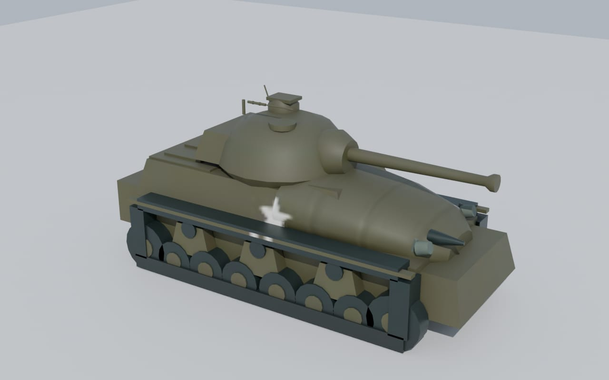
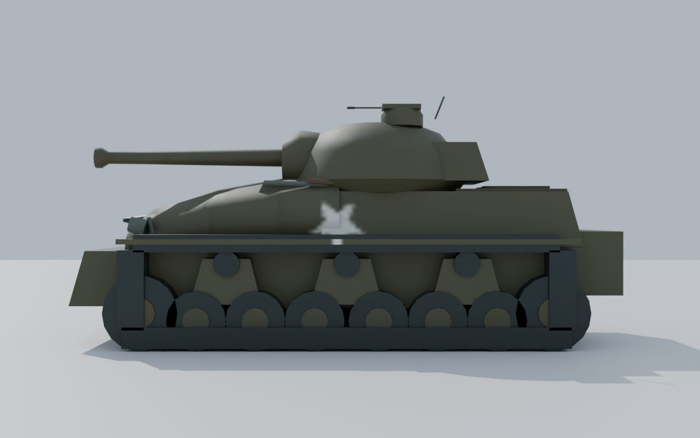
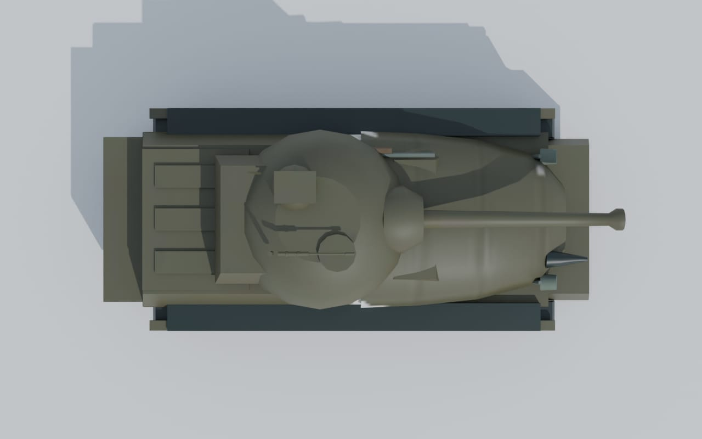
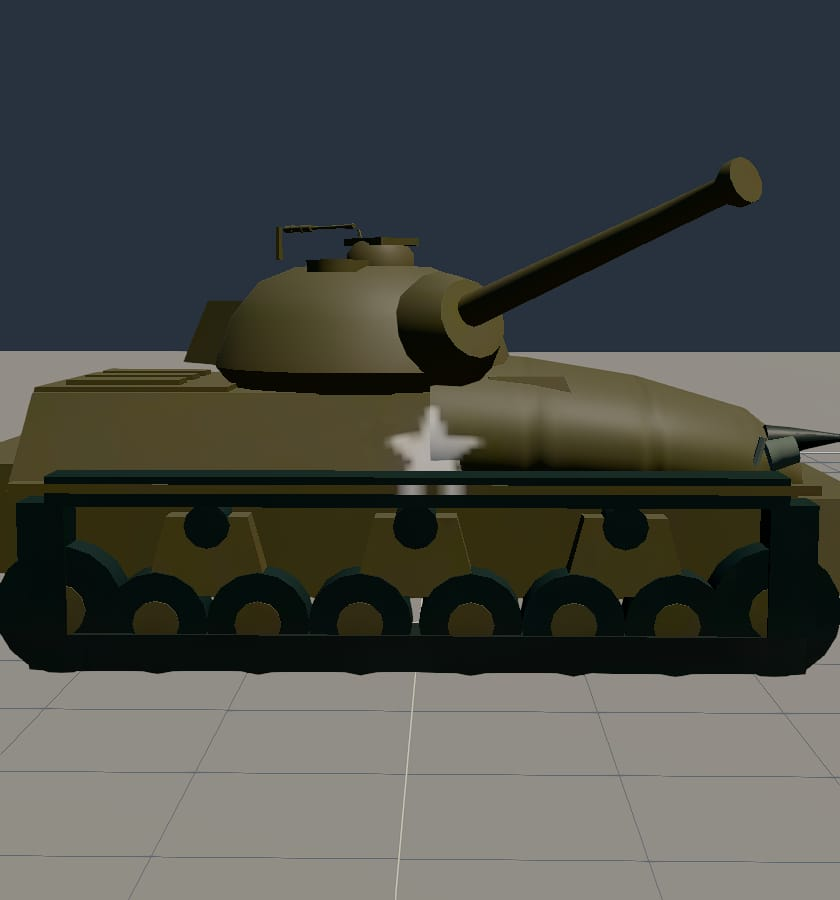
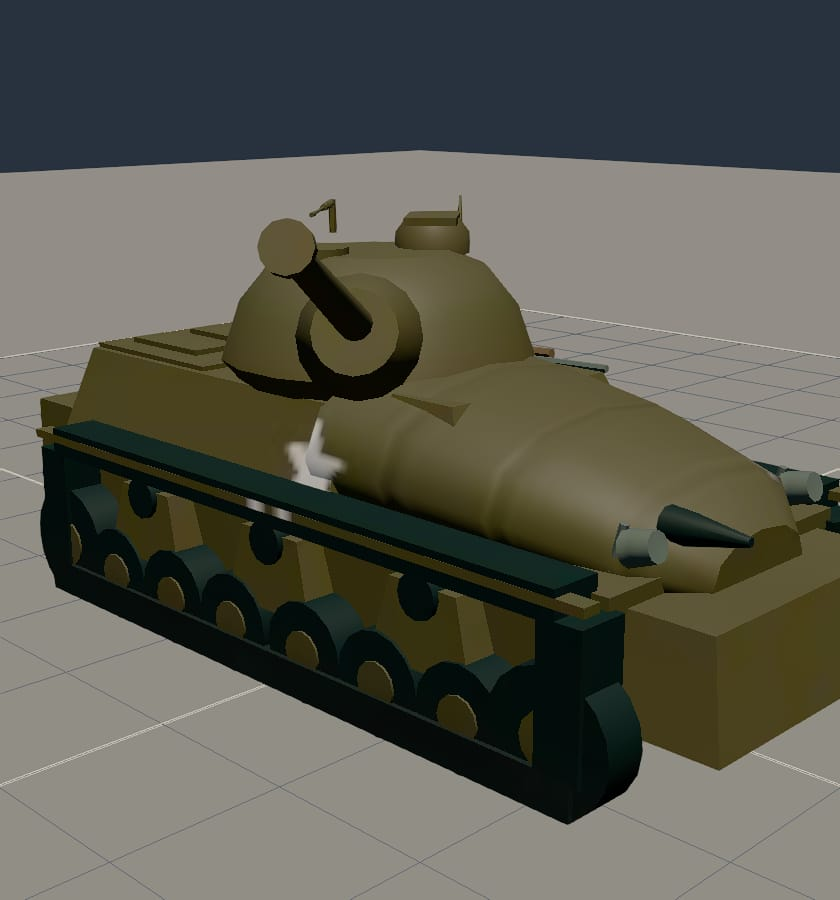

# M4 Composite Sherman

Integrated commit: `bdd507ed Add M4 Sherman vehicle model`

Status: merged into `main` on 2026-10-11; the feature worktree and branch were removed after integration

## Result

This branch adds an original, procedural Blender model of a U.S. 75 mm M4 Composite Sherman for the Library and Hangar. The vehicle uses the same interactive mount interface as the Type 97 Chi-Ha: the turret traverses continuously and the gun elevates independently. It is a display asset only and does not add a simulated ground unit.

The model represents the late-production composite-hull Sherman used in the Philippines: cast front hull, welded rear hull, 75 mm M3 gun in the M34A1 mantlet, VVSS suspension, commander's cupola, rear engine deck and stowage. The procedural source, generated GLB, manifest, sidecar and Library record are all committed.

## Review renders

| Blender front quarter | Blender side | Blender top |
| --- | --- | --- |
|  |  |  |

| Hangar side | Hangar turret trained and gun elevated |
| --- | --- |
|  |  |

## Sources and measurements

- The U.S. Army's 1944 *Standard Ordnance Items Catalog* supplies the M4's dimensions, 75 mm armament and performance: 19 ft 4 in long, 8 ft 7 in wide, 9 ft high, 83 in tread centers, 17.5 in ground clearance and 24 mph maximum speed.
- The U.S. Army campaign history *Leyte: The Return to the Philippines* establishes American tank operations in the campaign.
- The Australian War Memorial photograph documents Shermans near Breakneck Ridge on Leyte on 19 November 1944.
- Composite-hull identification and small fittings are explicitly recorded as estimates from wartime photographs, rather than asserted as catalog measurements.

The source URLs and attribution notes are preserved in `content/library/m4-sherman.json` and `ASSETS.md`.

## Articulation and budget

- Nodes: `Turret1` and `Gun1`
- Turret: unrestricted yaw around the vehicle's up axis
- Gun: -10° depression to +25° elevation, clamped by the rig
- Mount kit: `m4-75mm`
- Generated asset: 268,300 bytes, 3,796 triangles, 3 draw calls
- Vehicle budget: under 1 MB, 20,000 triangles and 8 draw calls

## Verification

- Blender model build completed on the Ryzen builder.
- Focused model, rig, registry, sidecar and Hangar tests passed.
- Real-GPU Hangar checks passed on the Nexus 680M, including loading every committed vehicle and exercising the Sherman's turret and gun limits.
- The capture test passed and produced the Hangar images above.
- Blender front-quarter, side and top previews were rendered and visually inspected.
- Full verification completed with 6,127 passing tests, 11 skipped and one failure in the unrelated Escort mission's easy/unescorted balance assertion. The same assertion fails unchanged on `main` (`lost(w)` is 1 while the test expects more than 1); all 31 focused Sherman model and rig tests passed again alongside that comparison.
