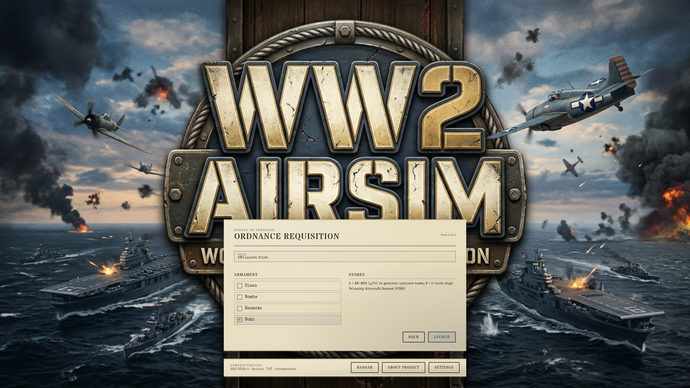
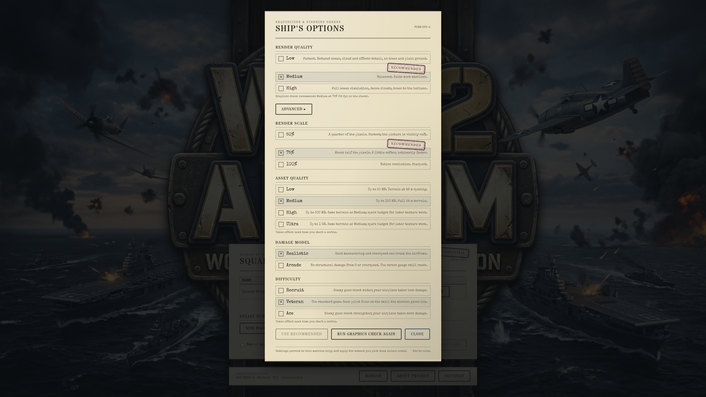
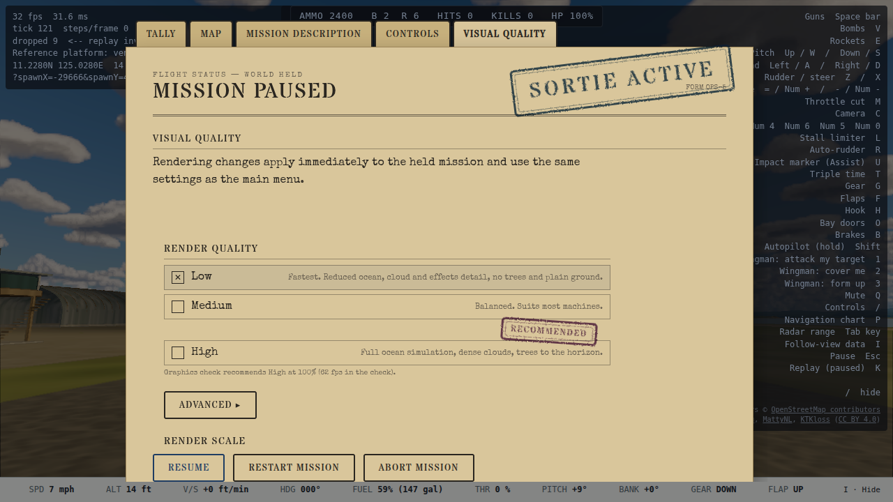
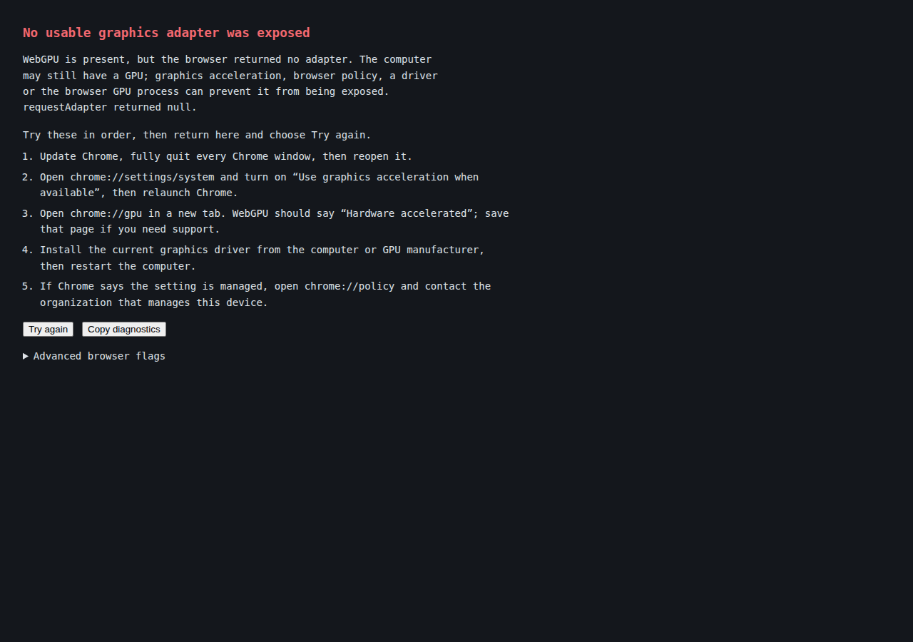

# A6 handoff: preflight graphics check and shared rendering settings (2026-10-11)

Plan: `docs/superpowers/plans/2026-10-11-preflight-graphics-check.md`. Branch `gpu-quality-check`, rebased onto `main` at `9e53d9c2`. Unattended run; final-product checkpoint only.

## Product decision

Rendering configuration is a session-wide concern, not a mission choice.

- On the first automatic visit, the title remains in its loading state while a **graphics check** exercises the fully built title scene. This happens before the player chooses a mission, but after shaders, terrain and vegetation exist, so it measures real rendering work without making the player launch and then restart a sortie.
- The check recommends one combined **Render Quality + Render Scale** profile. The result is saved and reused while the graphics adapter, browser major version and rendered pixel count remain comparable.
- **Settings** is the one complete editor. Form 4 no longer duplicates its controls; the administration memo shows the active adapter, profile and whether it is recommended or custom, with a Settings button.
- The **pause dossier** embeds the same settings implementation directly. It exposes only Render Quality and Render Scale because asset quality needs a reload and damage/difficulty are not rendering controls that should change accidentally in this surface.
- Any explicit quality or scale pick changes the mode to **Custom** and wins immediately, including a pick made while the check is running. “Use recommended” returns to the measured pair. “Run graphics check again” is available from main-menu Settings and reloads into a fresh check.

This replaces A4's first-flight probe. The player no longer chooses rendering quality during mission selection and no longer starts the first sortie with settings that can change underneath it.

## What the check measures

`src/render/graphicsCheck.ts` tries these profiles from most to least demanding:

1. High / 100%
2. High / 75%
3. Medium / 100%
4. Medium / 75%
5. Low / 75%
6. Low / 50%

Each candidate warms up, then records completed frames using the renderer's real WebGPU `queue.onSubmittedWorkDone()` seam. A candidate passes at **50 fps or better** and **150 ms or lower p95 queue-completion latency**. The first passing candidate is saved; Low/50% is the safe floor. Measuring completion rather than only `requestAnimationFrame` avoids recommending a profile merely because JavaScript submitted frames faster than the GPU finished them.

The saved record includes adapter identity, physical render size, browser major version, candidate measurements and timestamp. A record is current only for the same adapter and browser major, with pixel count within 25%; a materially different display or environment automatically checks again. DEV query overrides still win.

## Browser cannot expose a GPU

The failure UI deliberately does **not** claim the computer has no GPU. It distinguishes absent WebGPU, no adapter, and a software adapter, then offers an ordered Chrome/Edge guide:

1. update and fully relaunch the browser;
2. enable graphics acceleration in the browser system settings;
3. inspect `chrome://gpu` or `edge://gpu` for hardware-accelerated WebGPU;
4. update the manufacturer GPU driver and restart;
5. on Windows multi-GPU systems, assign the browser to **High performance** graphics;
6. inspect managed browser policy when the setting is controlled by an organization.

Advanced blocklist flags are present behind a warning and are explicitly framed as temporary diagnostics, not the first fix. The screen also has Try again and Copy diagnostics actions and is plain DOM so it still renders when WebGPU is the failed subsystem.

## Measured results

Both acceptance machines chose a sensible different profile at 2560×1440:

| Machine | Adapter | Candidate evidence | Recommendation |
| --- | --- | --- | --- |
| Ryzen reference desktop | AMD RX 6700 XT (`rdna-2`), headed Chrome 154 | High/100%: 81.55 fps, 96.8 ms p95, 90 completed frames | **High / 100%** |
| nexus | AMD Radeon 680M (`rdna-2`), Chromium 153 | High/100%: 32.07 fps, 238.7 ms; High/75%: 42.82 fps, 184.6 ms; Medium/100%: 37.67 fps, 214.3 ms; Medium/75%: 56.13 fps, 139.4 ms | **Medium / 75%** |

The 150 ms completion threshold was set only after observing both GPUs. A 50 ms threshold rejected every Nexus candidate because completion includes several queued frames; the chosen threshold still rejects all three profiles that miss 50 fps there and accepts High/100% comfortably on the reference desktop.

## Captures

| Surface | Capture |
| --- | --- |
| Form 4 has only a read-only graphics summary and Settings link |  |
| Main-menu Settings owns the recommended quality and scale |  |
| Pause dossier embeds the common live-safe controls |  |
| No-adapter recovery explains that the browser may be hiding a GPU |  |

## Verification

- `tests/render/graphicsCheck.test.ts`: profile order, dual thresholds, fallback, persistence, freshness and cancellation. The cancellation test was mutation-checked: making `cancel()` a no-op failed it (`measuring` instead of `cancelled`), then the implementation was restored and all 9 tests passed.
- Focused model/wiring suites passed (82 selected tests after the final implementation changes), with typecheck and lint green.
- Nexus GPU E2E passed for the preflight/persistence flow, Form 4 summary, custom-mode behavior, shared pause controls and no-adapter recovery. The final title run recorded the Medium/75% result in the table above.
- The headed reference-Chrome gate passed and recorded High/100% on the RX 6700 XT.
- The final rebased `npm run verify` passed typecheck, lint and dependency-cruiser; 413 of 415 test files and 5,840 tests passed. Two unchanged 30-second budget tests timed out only under whole-suite contention (`aiLethality.test.ts`, `soak.test.ts`). Both files passed together immediately afterward: 15 tests in 26.24 s, with the timed sections taking 14.49 s and 14.43 s respectively.

## Deliberate limits

- This is a short representative-scene check, not a benchmark database. It does not upload hardware identity or scores.
- It does not continually auto-tune during a sortie. Automatic selection happens at preflight; explicit player choices remain authoritative.
- Asset Quality remains a next-load setting and is omitted from the pause surface.
- Firefox/Safari-specific recovery copy is not claimed. The supported recovery guide currently targets Chrome and Edge, matching the tested WebGPU path.
