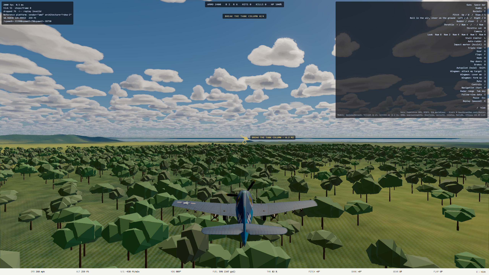
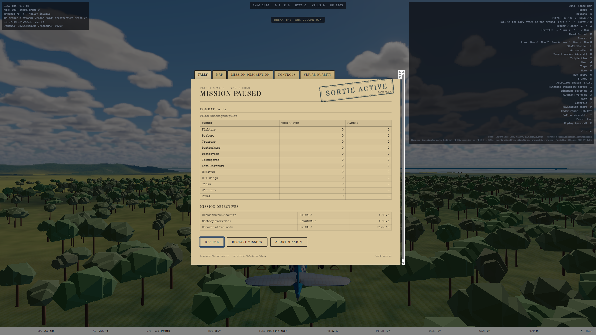

# Tank Buster mission handoff

**Date:** 2026-10-11

**Branch:** `tank-buster-mission`

**Plan:** `docs/superpowers/plans/2026-10-11-tank-buster-mission.md`
**Run mode:** unattended, final-product checkpoint

## Delivered

- Added **Tank Buster**, a production Leyte mission for the F6F-5 Hellcat. The player begins six miles north of the target, pointed south down the attack run, carrying six HVARs, two 1,000 lb bombs and the aircraft's six .50-caliber guns.
- Placed six Japanese tanks as three close pairs southwest of Dulag. Destroying four opens the Tacloban recovery objective; destroying all six completes the secondary objective.
- Added stationary scenario vehicles to the deterministic simulation and existing structure-damage/objective pipeline. Tanks accept gun, rocket and bomb damage, retain a deterministic wreck pose, and do not inflate the buildings-razed statistic.
- Reused the existing Type 97 Chi-Ha model and rig through the shared model cache. The mission history explicitly identifies it as a temporary visual stand-in for the Type 89 and Type 95 tanks better documented on Leyte.
- Added a first-class **Tanks** row to live pause, debrief and career accounting. Each tank is worth 300 points.
- Cleared procedural vegetation for 12 m around each authored hull so the column remains visible and attackable without flattening the jungle between target pairs.
- Added the Tank Buster ribbon, mission-menu enrollment, radio text registration, library status and gameplay/master-plan documentation.

## Historical basis

US tanks did fight in the Philippines, including tank-versus-tank actions. M3 Stuarts of the Provisional Tank Group met Japanese Type 95 light tanks in the 1941–42 campaign. During the 1944–45 return, M4 Shermans and M5 Stuarts fought Japanese armor; the January 1945 action at San Manuel, Luzon, was a substantial tank battle.

Tank Buster is a playable composite inspired by the Japanese 7th Independent Tank Company's operations along the Dulag–Burauen road on Leyte. It does not claim to reconstruct a specific recorded sortie.

Sources:

- US Army, *The Fall of the Philippines*: https://history.army.mil/portals/143/Images/Publications/catalog/5-2.pdf
- US Army, *Leyte: The Return to the Philippines*: https://www.govinfo.gov/content/pkg/GOVPUB-D114-PURL-gpo107815/pdf/GOVPUB-D114-PURL-gpo107815.pdf
- USAFPOA, *Intelligence Bulletin No. 11* (San Manuel): https://www.ibiblio.org/hyperwar/NHC/NewPDFs/USArmy/USAFPOA%20Intelligence%20Bulletin/USAFPOA%20Intelligence%20Bulletin%20No.%2011%201945-03-09.pdf

## Verification

- `npm run verify` on Ryzen: **PASS** — 414 files, 5,713 tests passed, 11 skipped.
- Final focused mission tests: **PASS** — scenario placement/terrain/ingress, weapon arithmetic, four-kill success, three-kill failure and six-kill secondary behavior.
- Focused Ryzen GPU E2E: **PASS** — six 48-HP tank simulation targets, six loaded vehicle models, two bombs/six rockets, no WebGPU validation errors, and live pause objectives/briefing.
- Visual capture flow on the Ryzen GPU: **PASS** — target-area approach and pause dossier inspected at 2560×1440.

## Final captures

## Deferred deliberately

- Replace the Chi-Ha stand-in with a Type 89 or Type 95 model for a closer Leyte armored-force match.
- Tank movement, suspension, weapons, crews, pathfinding and tank-versus-tank AI remain outside this mission's static ground-target contract.
