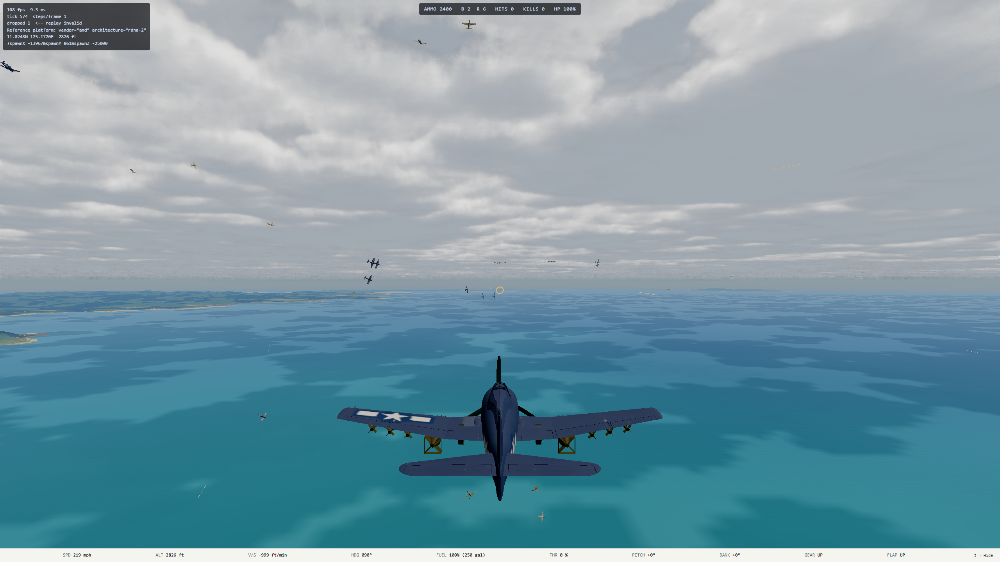
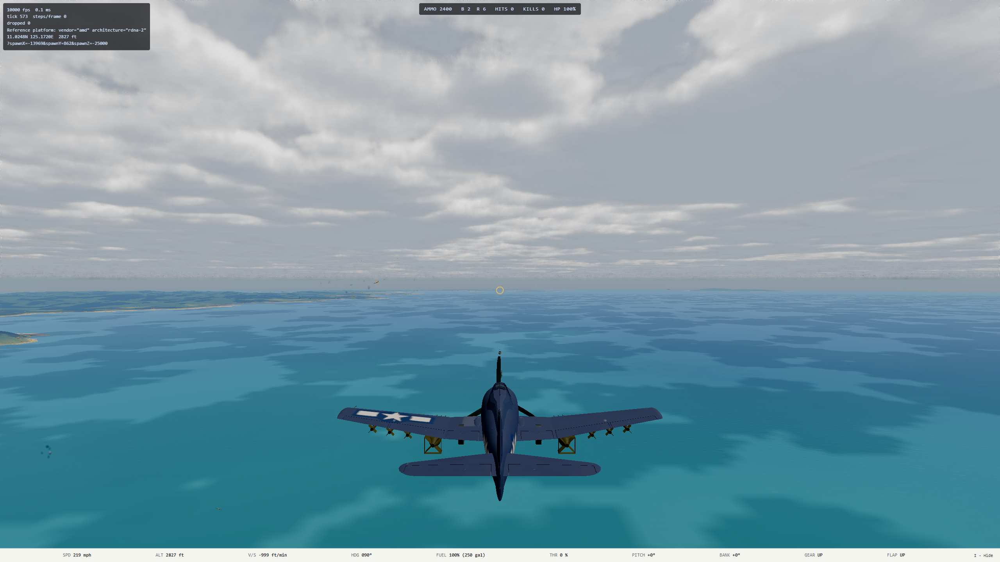

# Entity scaling after projectile broad phase and aircraft distance LOD

This is the reference GPU re-baseline requested after the two scaling fixes merged in `0ca520d9`.
It measures the frozen `main` revision `9aca2377` on 2026-10-12. The original measurement and its full
methodology are in [`2026-10-10-entity-scaling.md`](2026-10-10-entity-scaling.md).

## Answer

At 2560 × 1440, High, the 120 Hz target is still limited to about five extra aircraft or five extra
ships when **both** frozen GPU p95 and live main-thread work p95 must fit 8.33 ms. Ten extra aircraft
fit the GPU budget in both layouts, but main-thread tails are 8.8–9.0 ms. In an aircraft-only scene,
the GPU crosses the line between 10 and 20 close aircraft, and between 20 and 30 spread aircraft.
Mission 30 is right at the edge (8.41 ms GPU p95); it should not be called a reliable 120 Hz pass.

The fixes did move the larger battles substantially. At 30 extra aircraft the tight layout's live sim
cost fell to 1.63 ms/tick and its main-thread p95 to 13.6 ms; the mission layout uses 263 frozen draws
and 8.9 ms main-thread p95. Both aircraft-only layouts now fit the separate 16.7 ms CPU and GPU p95
bars for 60 Hz at 30 extra aircraft. Adding ten ships makes a tight 30-aircraft fight a near-edge
60 Hz case (16.10 ms GPU and 16.3 ms main-thread p95).

## How it was measured

- Frozen `main` at `9aca2377` in `/home/mark/projects/ww2airsim-entity-rebaseline`.
- Ryzen RX 6700 XT, Mark's active Windows console browser through Playwright, 2560 × 1440.
- `entityScalingCapture.spec.ts`, 24 High points in each of three repeats: 0/5/10/20/30/45/60
  extra aircraft, 5/10/20 extra ships, and 30+10/60+20 mixed, in tight and mission layouts.
  A ten-point Medium sweep, also repeated three times, checked the budget boundaries. Each point has a paused four-second GPU
  window, a six-second live 1× window, a four-second 3× window, and a pacing window with timestamp
  collection disabled.
- Every capture ran under `hwlock ryzen-budget`; Ryzen was near idle before each batch (about
  2–6% CPU, with no other lock holder). All capture cases passed and reported no WebGPU validation
  errors (120 captures total). Tables use the median of each row's three repeats. Frozen GPU p95 is the GPU budget measure;
  live GPU timestamps are affected by CPU-driven clock changes.
- Raw records: [`High JSONL`](2026-10-12-entity-scaling-rebaseline-shots/high.jsonl),
  [`Medium JSONL`](2026-10-12-entity-scaling-rebaseline-shots/medium.jsonl),
  [`ship-hide JSONL`](2026-10-12-entity-scaling-rebaseline-shots/ship-hide.jsonl), and
  [`effects-off JSONL`](2026-10-12-entity-scaling-rebaseline-shots/effects-off.jsonl).
  Run the existing [`aggregate.py`](2026-10-10-entity-scaling-shots/aggregate.py) against each file
  to regenerate the tables.

## High tier results

N and M are extra aircraft and ships on top of free flight's two aircraft and three ships. The GPU
columns are from the frozen window; work and sim are from the live 1× window. All times are ms.

| Layout | N | M | GPU p50 | GPU p95 | Frozen draws | Work p95 | Sim/tick |
| --- | ---: | ---: | ---: | ---: | ---: | ---: | ---: |
| tight | 0 | 0 | 5.06 | 5.13 | 112 | 4.7 | 0.35 |
| tight | 5 | 0 | 5.08 | 5.57 | 186 | 6.4 | 0.50 |
| tight | 10 | 0 | 4.76 | 5.68 | 275 | 9.0 | 0.75 |
| tight | 20 | 0 | 5.26 | 9.22 | 321 | 11.0 | 0.86 |
| tight | 30 | 0 | 6.66 | 13.88 | 517 | 13.6 | 1.63 |
| tight | 45 | 0 | 7.29 | 14.99 | 672 | 16.5 | 2.54 |
| tight | 60 | 0 | 8.96 | 15.64 | 793 | 16.3 | 2.97 |
| tight | 0 | 5 | 5.14 | 6.39 | 163 | 8.1 | 0.48 |
| tight | 0 | 10 | 5.96 | 12.78 | 224 | 9.4 | 0.53 |
| tight | 0 | 20 | 7.75 | 14.60 | 323 | 11.4 | 0.74 |
| tight | 30 | 10 | 10.50 | 16.10 | 630 | 16.3 | 2.00 |
| tight | 60 | 20 | 16.86 | 19.96 | 1,005 | 21.7 | 4.28 |
| mission | 0 | 0 | 5.04 | 5.34 | 112 | 6.6 | 0.35 |
| mission | 5 | 0 | 5.09 | 5.71 | 186 | 7.8 | 0.45 |
| mission | 10 | 0 | 4.80 | 6.48 | 242 | 8.8 | 0.57 |
| mission | 20 | 0 | 5.32 | 6.39 | 253 | 8.6 | 0.75 |
| mission | 30 | 0 | 5.44 | 8.41 | 263 | 8.9 | 0.94 |
| mission | 45 | 0 | 6.02 | 11.66 | 278 | 9.4 | 1.26 |
| mission | 60 | 0 | 6.17 | 10.83 | 293 | 9.4 | 1.64 |
| mission | 0 | 5 | 5.09 | 6.19 | 158 | 7.5 | 0.46 |
| mission | 0 | 10 | 5.46 | 10.00 | 202 | 7.6 | 0.51 |
| mission | 0 | 20 | 6.82 | 14.24 | 280 | 10.0 | 0.71 |
| mission | 30 | 10 | 7.17 | 14.05 | 353 | 11.3 | 1.19 |
| mission | 60 | 20 | 14.20 | 16.06 | 461 | 14.7 | 2.37 |

Frozen draw counts at 60 aircraft fell to 793 (tight) and 293 (mission). The spread layout gains more
because its distant groups use the one-draw aircraft proxy. Its far proxy retains the source triangles:
mission 60 still draws about 5.1 million triangles, versus 2.9 million at 0 aircraft. This explains why
far-aircraft GPU time keeps rising after submission cost is reduced. The paused GPU p95 is somewhat noisy
at high counts; for example mission 45 is 11.66 ms and mission 60 is 10.83 ms, so use boundary ranges,
not monotonic extrapolation.

## Comparison with the original measurement

The 2026-10-10 baseline used an older `main` with different scenery and UI code. These are directional
across-version comparisons, not an isolated A/B for either fix. The earlier feature handoffs contain
the controlled A/B measurements.

| Point | Old → new frozen GPU p95 | Old → new draws | Old → new live work p95 | Old → new sim/tick |
| --- | ---: | ---: | ---: | ---: |
| Tight 30 aircraft | 17.19 → 13.88 | 858 → 517 | 25.8 → 13.6 | 6.43 → 1.63 |
| Mission 30 aircraft | 14.93 → 8.41 | 854 → 263 | 15.8 → 8.9 | 0.88 → 0.94 |
| Tight 60 aircraft + 20 ships | 24.28 → 19.96 | 1,954 → 1,005 | 129.7 → 21.7 | 14.12 → 4.28 |
| Mission 60 aircraft + 20 ships | 21.49 → 16.06 | 1,910 → 461 | 37.1 → 14.7 | 2.42 → 2.37 |

## Remaining cost and next order

Three-repeat ablations on this same revision give payoff ceilings, not promises for a specific future LOD.

| Point | Variant | Frozen GPU p95 | Draws | Live work p95 |
| --- | --- | ---: | ---: | ---: |
| Tight 20 ships | visible | 14.60 | 323 | 11.4 |
| Tight 20 ships | swarm hidden | 6.58 | 112 | 6.1 |
| Mission 20 ships | visible | 14.24 | 280 | 10.0 |
| Mission 20 ships | swarm hidden | 6.71 | 112 | 5.8 |
| Tight 30 aircraft | effects on | 13.88 | 517 | 13.6 |
| Tight 30 aircraft | effects off | 12.16 | 513 | 13.2 |
| Tight 30 aircraft + 10 ships | effects on | 16.10 | 630 | 16.3 |
| Tight 30 aircraft + 10 ships | effects off | 15.24 | 626 | 15.4 |

**Next:** reduce ship draw calls in a separate implementation pass, while preserving gun mounts, damage,
and sinking nearby. The ship-only ablation is larger than the tight-combat effects ablation, and mixed
task forces cross the GPU bar before main-thread work. Then remeasure the mixed ceiling. For
aircraft-only tight fights, the remaining near-aircraft submissions and effects deserve a separate
profile. A lower-triangle far-aircraft proxy is a later option for large spread formations.

## Medium tier spot check

Medium changes the cloud and scenery cost but does not move the observed 120 Hz boundary by a full
entity step. Each entry is frozen GPU p95, median of three repeats; High comes from the full matrix above.

| Layout | Extra aircraft | Extra ships | High p95 | Medium p95 |
| --- | ---: | ---: | ---: | ---: |
| tight | 0 | 0 | 5.13 | 5.14 |
| tight | 20 | 0 | 9.22 | 9.82 |
| tight | 30 | 0 | 13.88 | 13.98 |
| tight | 0 | 10 | 12.78 | 11.59 |
| tight | 30 | 10 | 16.10 | 14.47 |
| mission | 0 | 0 | 5.34 | 4.71 |
| mission | 20 | 0 | 6.39 | 6.00 |
| mission | 30 | 0 | 8.41 | 9.71 |
| mission | 0 | 10 | 10.00 | 12.02 |
| mission | 30 | 10 | 14.05 | 13.37 |

The p95 tails are not monotonic between independent High and Medium batches. Medium's lower baseline
and some lower mixed-scene costs are real observations, but the noisy edge rows support the same
capacity bands, not a stronger tier-specific claim.

## Visual checkpoint

The full near models, far silhouettes, combat effects and ships are visible in the fixed High captures:

This measurement did not change game code or assets. No production deployment followed.
