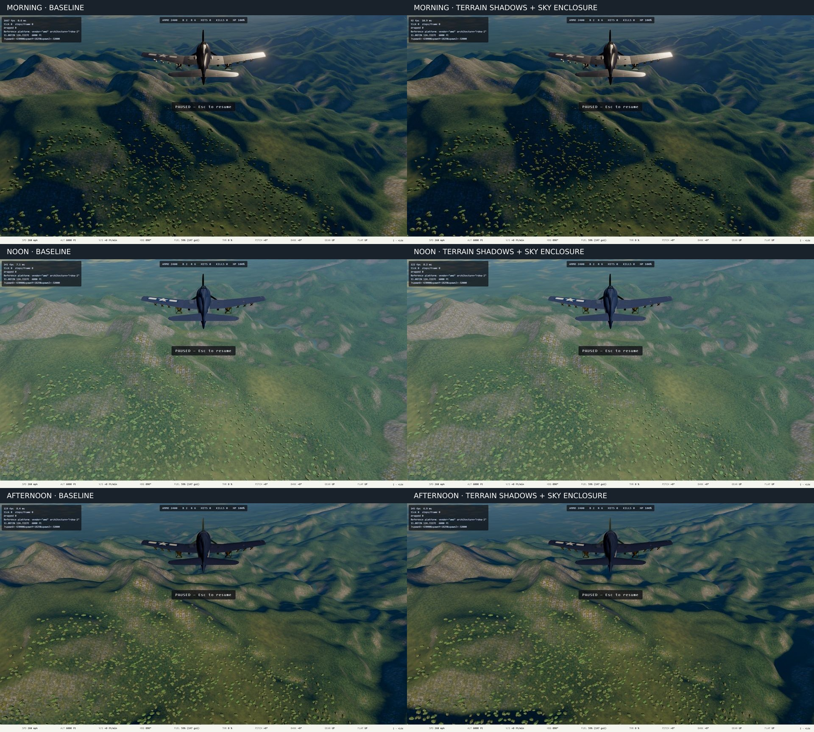

# Terrain lighting — checkpoint 1, 2026-10-13

**Subsequent ruling:** Mark perceived no difference. The prototype is now off
by default after measuring its added cost. See [feedback and tree cost](2026-10-13-terrain-cost.md).
The captures below remain the historical experiment, not an accepted improvement.

First visual checkpoint of the [attended plan](../superpowers/plans/2026-10-13-terrain-lighting.md).
Worktree `terrain-lighting`, slot 2 (port 5175). Surface/canopy work waits for
Mark's feedback. No merge or production deployment.

## Review

The camera is held at 6,000 ft, heading east, at world x=-63000/z=-32000.
Morning is 07:30, noon 12:00, afternoon 16:30. The larger changes occur at
lower sun angles: ridges shadow neighboring valleys. Noon is intentionally
subtle because the high sun clears most horizons. Original terrain colors,
material detail and tree meshes remain visible; this does not fix their
synthetic appearance yet. No drape is loaded.

Live query (append to the slot hostname):

`/?spawnX=-63000&spawnY=1828.8&spawnZ=-32000&sceneryView=1&cloudTier=off&oceanTier=high&timeOfDay=7.5&launch=1&terrainLighting=on`

Change `terrainLighting` to `off` for the baseline, `sky` for diffuse enclosure
alone, or `sun` for cast shadow alone. Change `timeOfDay` to `12` or `16.5` for
the other captures. These inspection links deliberately hold the camera;
remove `sceneryView=1` for ordinary flight.

## Verification

- Full `npm run verify` on Ryzen: 437 files passed; 6,394 tests passed and
  12 existing named skips. This ran before the final interpolator-sharing fix;
  afterward typecheck, focused lint and all 17 horizon/surface tests passed.
- Existing terrain load/surface checks plus new horizon behavior: 42 passed.
- Final reference-GPU run: all six matched captures and the comparison-mode /
  invalid-map fallback check passed, with zero console or WebGPU errors.
- The first GPU attempt exposed a vertex-output-location overflow. Sharing
  the existing world-coordinate interpolator fixed it; the error detector
  failed before that fix and passed afterward.
- Slot and comparison image returned HTTP 200 before handoff.
- No isolated GPU performance measurement yet. The frame-rate overlays in
  these captures are **not budget evidence**: CPU verification overlapped
  captures. Performance clearance remains in the later integration phase.

## Scope and limits

The whole-world prototype costs 17,860,625 decoded texture bytes and
4,196,248 compressed bytes, plus its header. Spatial spacing is approximately
641 ft with 16 azimuth directions and a filtered sun transition. Narrow
gullies and exact shadow boundaries need further resolution assessment.
Terrain shadows affect terrain only; trees, buildings and airplanes still
use their existing light model. No claim of final photorealism or production
readiness is made at this checkpoint.

## Test reconciliation so far

**Tests updated:** `landGapCapture.spec.ts` gains the terrain-lighting view
enrollment and durable capture output; `terrainTextures.spec.ts` checks all
four modes and invalid metadata fallback. `terrainHorizons.test.ts` checks
flat/tilted planes, a known ridge, an enclosing bowl, exposed peak and layer
orientation/sea neutrality.

**Tests still valid:** terrain height/contact, streaming/windows and material
blend tests: no physics elevation, coverage or surface-color changes.

**Known gaps:** isolated GPU cost, shadow receipt by scene objects, flight
across the horizon raster at changing sun, and resolution at narrow ravines.
Final canopy/surface review and complete branch closeout remain pending.
